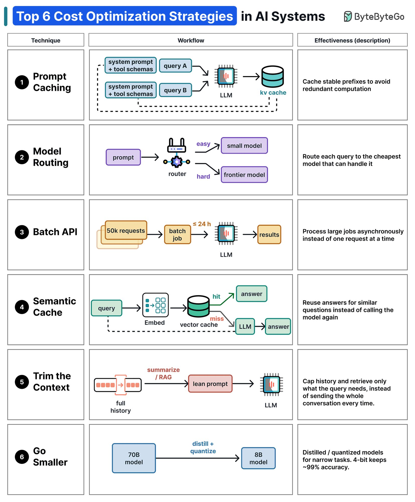

# ByteByteGo《Top 6 Cost Optimization Strategies in AI Systems》导读：AI 系统成本优化六策

[← 返回目录](index.md)

> 来源：ByteByteGo（Alex Xu），X 帖《Top 6 Cost Optimization Strategies in AI Systems》，2026-11-02。原文：https://x.com/alexxubyte/status/2117302471156781430
> 本篇是导读 + 重绘图；清单第 52 份，组七 Agent Ops。上方是矢量重绘（文字可选中、可任意缩放），下方附 ByteByteGo 原图供对照。

## 一句话结论

调用大模型最烧钱的地方往往不是模型本身，而是每次调用时重复花的冤枉钱：六条打法——提示词缓存、模型路由、批量接口、语义缓存、精简上下文、用小模型——分别从缓存、路由、批量、复用、瘦身、换小模型六个方向省。

## 为什么值得看

这是一张速查表，不是一篇长文。六条每条一句话，合起来就是一张 AI 系统成本优化的全图：跟清单里已有的选型/成本内容（比如 Hamel 的决策模型）互补，不重复；跟 AI FinOps 方向和 thinktank 的成本意识都咬合。读的时候不用逐条精读，对着自己的系统逐条过一遍，哪条没做、哪条能做，就够了。

  <table>
    <thead>
      <tr><th>#</th><th>策略</th><th>流程</th><th>省在哪</th></tr>
    </thead>
    <tbody>
      <tr>
        <td class="num">1</td>
        <td class="tech">
Prompt Caching

提示词缓存
</td>
        <td class="flow">
          <svg viewBox="0 0 380 112" role="img" aria-labelledby="costopt-f1-title costopt-f1-desc">
            <title id="costopt-f1-title">提示词缓存流程</title>
            <desc id="costopt-f1-desc">固定前缀存入 KV 缓存，重复请求复用缓存，生成结果写回缓存。</desc>
            <defs><marker id="arr1" viewBox="0 0 10 10" refX="8" refY="5" markerWidth="7" markerHeight="7" orient="auto-start-reverse"><path d="M0,0 L10,5 L0,10 z" fill="#2d3142" fill-opacity=".5"/></marker></defs>
            <rect x="0" y="8" width="132" height="48" rx="6" fill="#fff" stroke="#2d3142" stroke-opacity=".28"/>
            <text class="node-name" x="66" y="28" text-anchor="middle">固定前缀</text>
            <text class="node-sub" x="66" y="45" text-anchor="middle">系统提示 · 工具定义</text>
            <line x1="132" y1="32" x2="156" y2="32" stroke="#2d3142" stroke-opacity=".5" stroke-width="1.5" marker-end="url(#arr1)"/>
            <rect x="160" y="8" width="100" height="48" rx="6" fill="#fff" stroke="#2d3142" stroke-opacity=".28"/>
            <text class="node-name" x="210" y="28" text-anchor="middle">KV 缓存</text>
            <text class="node-sub" x="210" y="45" text-anchor="middle">前缀只算一次</text>
            <line x1="260" y1="32" x2="284" y2="32" stroke="#2d3142" stroke-opacity=".5" stroke-width="1.5" marker-end="url(#arr1)"/>
            <rect x="288" y="8" width="92" height="48" rx="6" fill="#fff" stroke="#2d3142" stroke-opacity=".28"/>
            <text class="node-name" x="334" y="28" text-anchor="middle">LLM</text>
            <text class="node-sub" x="334" y="45" text-anchor="middle">复用缓存生成</text>
            <path d="M334,56 V84 H210 V60" fill="none" stroke="#2d3142" stroke-opacity=".5" stroke-width="1.5" stroke-dasharray="5,4" marker-end="url(#arr1)"/>
            <text class="edge-label" x="272" y="102" text-anchor="middle">写回缓存</text>
          </svg>
        </td>
        <td class="why">固定前缀只算一次，重复请求不再为同一段提示词付费。</td>
      </tr>
      <tr>
        <td class="num">2</td>
        <td class="tech">
Model Routing

模型路由
</td>
        <td class="flow">
          <svg viewBox="0 0 360 116" role="img" aria-labelledby="costopt-f2-title costopt-f2-desc">
            <title id="costopt-f2-title">模型路由流程</title>
            <desc id="costopt-f2-desc">路由器按难度分流：简单问题走小模型，难题走前沿模型。</desc>
            <defs><marker id="arr2" viewBox="0 0 10 10" refX="8" refY="5" markerWidth="7" markerHeight="7" orient="auto-start-reverse"><path d="M0,0 L10,5 L0,10 z" fill="#2d3142" fill-opacity=".5"/></marker></defs>
            <rect x="0" y="34" width="88" height="48" rx="6" fill="#fff" stroke="#2d3142" stroke-opacity=".28"/>
            <text class="node-name" x="44" y="54" text-anchor="middle">用户提问</text>
            <text class="node-sub" x="44" y="71" text-anchor="middle">任意难度</text>
            <line x1="88" y1="58" x2="112" y2="58" stroke="#2d3142" stroke-opacity=".5" stroke-width="1.5" marker-end="url(#arr2)"/>
            <rect x="116" y="34" width="88" height="48" rx="6" fill="#fff" stroke="#2d3142" stroke-opacity=".28"/>
            <text class="node-name" x="160" y="54" text-anchor="middle">路由器</text>
            <text class="node-sub" x="160" y="71" text-anchor="middle">按难度分流</text>
            <path d="M204,46 H218 V30 H228" fill="none" stroke="#2d3142" stroke-opacity=".5" stroke-width="1.5" marker-end="url(#arr2)"/>
            <path d="M204,70 H218 V86 H228" fill="none" stroke="#2d3142" stroke-opacity=".5" stroke-width="1.5" marker-end="url(#arr2)"/>
            <rect x="232" y="6" width="128" height="48" rx="6" fill="#fff" stroke="#2d3142" stroke-opacity=".28"/>
            <text class="node-name" x="296" y="26" text-anchor="middle">小模型</text>
            <text class="node-sub" x="296" y="43" text-anchor="middle">简单问题 · 便宜</text>
            <rect x="232" y="62" width="128" height="48" rx="6" fill="#fff" stroke="#2d3142" stroke-opacity=".28"/>
            <text class="node-name" x="296" y="82" text-anchor="middle">前沿模型</text>
            <text class="node-sub" x="296" y="99" text-anchor="middle">难题 · 贵但能解</text>
          </svg>
        </td>
        <td class="why">简单问题走便宜的小模型，难题才上前沿模型。</td>
      </tr>
      <tr>
        <td class="num">3</td>
        <td class="tech">
Batch API

批量接口
</td>
        <td class="flow">
          <svg viewBox="0 0 440 64" role="img" aria-labelledby="costopt-f3-title costopt-f3-desc">
            <title id="costopt-f3-title">批量接口流程</title>
            <desc id="costopt-f3-desc">攒够一批请求后异步批量处理，24 小时内返回结果。</desc>
            <defs><marker id="arr3" viewBox="0 0 10 10" refX="8" refY="5" markerWidth="7" markerHeight="7" orient="auto-start-reverse"><path d="M0,0 L10,5 L0,10 z" fill="#2d3142" fill-opacity=".5"/></marker></defs>
            <rect x="0" y="8" width="96" height="48" rx="6" fill="#fff" stroke="#2d3142" stroke-opacity=".28"/>
            <text class="node-name" x="48" y="28" text-anchor="middle">5 万请求</text>
            <text class="node-sub" x="48" y="45" text-anchor="middle">攒够一批</text>
            <line x1="96" y1="32" x2="120" y2="32" stroke="#2d3142" stroke-opacity=".5" stroke-width="1.5" marker-end="url(#arr3)"/>
            <rect x="124" y="8" width="116" height="48" rx="6" fill="#fff" stroke="#2d3142" stroke-opacity=".28"/>
            <text class="node-name" x="182" y="28" text-anchor="middle">批量任务</text>
            <text class="node-sub" x="182" y="45" text-anchor="middle">≤24h 异步处理</text>
            <line x1="240" y1="32" x2="264" y2="32" stroke="#2d3142" stroke-opacity=".5" stroke-width="1.5" marker-end="url(#arr3)"/>
            <rect x="268" y="8" width="72" height="48" rx="6" fill="#fff" stroke="#2d3142" stroke-opacity=".28"/>
            <text class="node-name" x="304" y="28" text-anchor="middle">LLM</text>
            <text class="node-sub" x="304" y="45" text-anchor="middle">批量跑</text>
            <line x1="340" y1="32" x2="364" y2="32" stroke="#2d3142" stroke-opacity=".5" stroke-width="1.5" marker-end="url(#arr3)"/>
            <rect x="368" y="8" width="72" height="48" rx="6" fill="#fff" stroke="#2d3142" stroke-opacity=".28"/>
            <text class="node-name" x="404" y="28" text-anchor="middle">结果</text>
            <text class="node-sub" x="404" y="45" text-anchor="middle">一次返回</text>
          </svg>
        </td>
        <td class="why">大批量任务异步处理，换更低的批量价，不必逐条实时调用。</td>
      </tr>
      <tr>
        <td class="num">4</td>
        <td class="tech">
Semantic Cache

语义缓存
</td>
        <td class="flow">
          <svg viewBox="0 0 380 116" role="img" aria-labelledby="costopt-f4-title costopt-f4-desc">
            <title id="costopt-f4-title">语义缓存流程</title>
            <desc id="costopt-f4-desc">向量检索找相似问题：命中直接返回答案，未命中才调模型生成。</desc>
            <defs><marker id="arr4" viewBox="0 0 10 10" refX="8" refY="5" markerWidth="7" markerHeight="7" orient="auto-start-reverse"><path d="M0,0 L10,5 L0,10 z" fill="#2d3142" fill-opacity=".5"/></marker></defs>
            <rect x="0" y="34" width="72" height="48" rx="6" fill="#fff" stroke="#2d3142" stroke-opacity=".28"/>
            <text class="node-name" x="36" y="54" text-anchor="middle">提问</text>
            <text class="node-sub" x="36" y="71" text-anchor="middle">新问题</text>
            <line x1="72" y1="58" x2="96" y2="58" stroke="#2d3142" stroke-opacity=".5" stroke-width="1.5" marker-end="url(#arr4)"/>
            <rect x="100" y="34" width="104" height="48" rx="6" fill="#fff" stroke="#2d3142" stroke-opacity=".28"/>
            <text class="node-name" x="152" y="54" text-anchor="middle">向量检索</text>
            <text class="node-sub" x="152" y="71" text-anchor="middle">找相似问题</text>
            <path d="M204,46 H218 V30 H228" fill="none" stroke="#2d3142" stroke-opacity=".5" stroke-width="1.5" marker-end="url(#arr4)"/>
            <path d="M204,70 H218 V86 H228" fill="none" stroke="#2d3142" stroke-opacity=".5" stroke-width="1.5" marker-end="url(#arr4)"/>
            <rect x="232" y="6" width="148" height="48" rx="6" fill="#fff" stroke="#2d3142" stroke-opacity=".28"/>
            <text class="node-name" x="306" y="26" text-anchor="middle">直接返回答案</text>
            <text class="node-sub" x="306" y="43" text-anchor="middle">命中 · 零模型调用</text>
            <rect x="232" y="62" width="148" height="48" rx="6" fill="#fff" stroke="#2d3142" stroke-opacity=".28"/>
            <text class="node-name" x="306" y="82" text-anchor="middle">LLM 生成</text>
            <text class="node-sub" x="306" y="99" text-anchor="middle">未命中 · 现算</text>
          </svg>
        </td>
        <td class="why">相似问题直接复用已有答案，省一次模型调用。</td>
      </tr>
      <tr>
        <td class="num">5</td>
        <td class="tech">
Trim the Context

精简上下文
</td>
        <td class="flow">
          <svg viewBox="0 0 528 64" role="img" aria-labelledby="costopt-f5-title costopt-f5-desc">
            <title id="costopt-f5-title">精简上下文流程</title>
            <desc id="costopt-f5-desc">完整对话历史经摘要或 RAG 检索瘦身为精简提示词再送模型。</desc>
            <defs><marker id="arr5" viewBox="0 0 10 10" refX="8" refY="5" markerWidth="7" markerHeight="7" orient="auto-start-reverse"><path d="M0,0 L10,5 L0,10 z" fill="#2d3142" fill-opacity=".5"/></marker></defs>
            <rect x="0" y="8" width="128" height="48" rx="6" fill="#fff" stroke="#2d3142" stroke-opacity=".28"/>
            <text class="node-name" x="64" y="28" text-anchor="middle">完整对话历史</text>
            <text class="node-sub" x="64" y="45" text-anchor="middle">每轮都重发</text>
            <line x1="128" y1="32" x2="152" y2="32" stroke="#2d3142" stroke-opacity=".5" stroke-width="1.5" marker-end="url(#arr5)"/>
            <rect x="156" y="8" width="136" height="48" rx="6" fill="#fff" stroke="#2d3142" stroke-opacity=".28"/>
            <text class="node-name" x="224" y="28" text-anchor="middle">摘要 / RAG 检索</text>
            <text class="node-sub" x="224" y="45" text-anchor="middle">只取需要的</text>
            <line x1="292" y1="32" x2="316" y2="32" stroke="#2d3142" stroke-opacity=".5" stroke-width="1.5" marker-end="url(#arr5)"/>
            <rect x="320" y="8" width="116" height="48" rx="6" fill="#fff" stroke="#2d3142" stroke-opacity=".28"/>
            <text class="node-name" x="378" y="28" text-anchor="middle">精简提示词</text>
            <text class="node-sub" x="378" y="45" text-anchor="middle">瘦身后送模型</text>
            <line x1="436" y1="32" x2="460" y2="32" stroke="#2d3142" stroke-opacity=".5" stroke-width="1.5" marker-end="url(#arr5)"/>
            <rect x="464" y="8" width="64" height="48" rx="6" fill="#fff" stroke="#2d3142" stroke-opacity=".28"/>
            <text class="node-name" x="496" y="28" text-anchor="middle">LLM</text>
            <text class="node-sub" x="496" y="45" text-anchor="middle">只读必要</text>
          </svg>
        </td>
        <td class="why">只送当次查询需要的上下文，不再每轮重发全部历史。</td>
      </tr>
      <tr>
        <td class="num">6</td>
        <td class="tech">
Go Smaller

用小模型
</td>
        <td class="flow">
          <svg viewBox="0 0 416 64" role="img" aria-labelledby="costopt-f6-title costopt-f6-desc">
            <title id="costopt-f6-title">用小模型流程</title>
            <desc id="costopt-f6-desc">70B 模型经蒸馏与量化得到 8B 模型，4-bit 约保留 99% 准确率。</desc>
            <defs><marker id="arr6" viewBox="0 0 10 10" refX="8" refY="5" markerWidth="7" markerHeight="7" orient="auto-start-reverse"><path d="M0,0 L10,5 L0,10 z" fill="#2d3142" fill-opacity=".5"/></marker></defs>
            <rect x="0" y="8" width="96" height="48" rx="6" fill="#fff" stroke="#2d3142" stroke-opacity=".28"/>
            <text class="node-name" x="48" y="28" text-anchor="middle">70B 模型</text>
            <text class="node-sub" x="48" y="45" text-anchor="middle">大而全</text>
            <line x1="96" y1="32" x2="120" y2="32" stroke="#2d3142" stroke-opacity=".5" stroke-width="1.5" marker-end="url(#arr6)"/>
            <rect x="124" y="8" width="116" height="48" rx="6" fill="#fff" stroke="#2d3142" stroke-opacity=".28"/>
            <text class="node-name" x="182" y="28" text-anchor="middle">蒸馏 + 量化</text>
            <text class="node-sub" x="182" y="45" text-anchor="middle">瘦身</text>
            <line x1="240" y1="32" x2="264" y2="32" stroke="#2d3142" stroke-opacity=".5" stroke-width="1.5" marker-end="url(#arr6)"/>
            <rect x="268" y="8" width="148" height="48" rx="6" fill="#fff" stroke="#2d3142" stroke-opacity=".28"/>
            <text class="node-name" x="342" y="28" text-anchor="middle">8B 模型</text>
            <text class="node-sub" x="342" y="45" text-anchor="middle">4-bit ≈ 99% 准确率</text>
          </svg>
        </td>
        <td class="why">窄任务用蒸馏量化后的小模型，成本大降、准确率基本不丢。</td>
      </tr>
    </tbody>
  </table>

## 原图对照

原图：ByteByteGo（Alex Xu）2026-11-02 X 帖附图（GIF 大图）。重绘版与原图逐条对照：流程步骤一致，重绘版把每条的效果说明改写为中文，并删去了原图的品牌配色与动画。

来源：ByteByteGo（Alex Xu）2026-11-02 X 帖《Top 6 Cost Optimization Strategies in AI Systems》，[原帖](https://x.com/alexxubyte/status/2117302471156781430)。原图为 ByteByteGo 的 GIF（见上方原图对照）；重绘版六条策略与流程步骤忠实原图，效果说明改写为中文；删去原图品牌配色与动画。4-bit 约保留 99% 准确率是原图说法，适用于窄任务，不宜外推到所有任务。
