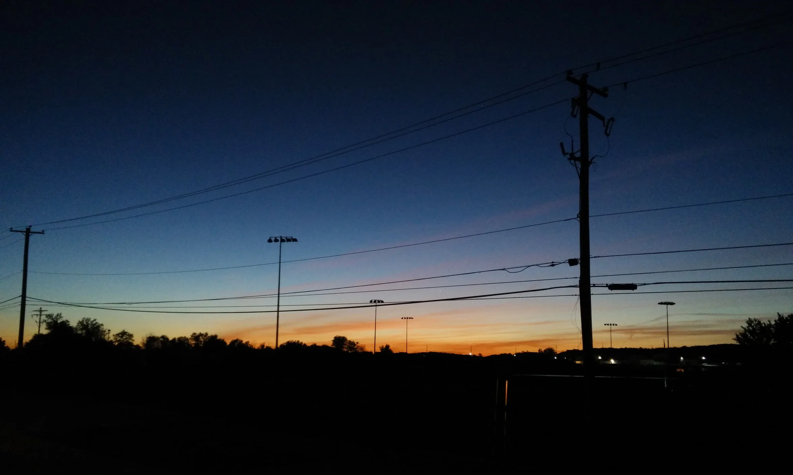

# AI 繁荣的前夜

[← 返回首页](../index.md)

*2026-11-01 · [English Version](./eve-of-ai-prosperity-en.md)*

前两天读到一篇大推主的文章，标题叫《AI 泡沫破裂的前夜》。写得很好，事实也扎实：Intel 一天跌 28%，Google 一天蒸发 5000 亿美金，SanDisk 财报超预期还跌 13%，Reddit 因为 Google AI Mode 直接给答案、流量掉了 29%。他的核心论点是：AI 把生产力提上去了，写代码一年顶过去十年，但到 2026 年 10 月 31 日为止，他看不到 AI 创造了什么真正的“增量价值”。智能变得不稀缺了，不稀缺的东西就没有价值；没有中间商赚差价，交易循环转不起来；赚到的钱全投回 AI 基建去了。所以 AI 的本质既不是 2B 也不是 2C，而是 2me——自娱自乐经济。

我得承认，他说的痛点都是真的。我天天用 AI 写代码、做分析，我太清楚那种感觉了：生产力确实上去了，但钱并没有跟着多起来。蓝莓产量涨 39%、价格跌一半，买蓝莓的人是开心了，种蓝莓的人呢？这话没错。

但他的结论，我觉得走过头了。

他把“生产者还没赚到钱”等同于“社会没有增量价值”。这一步跳得太远了。蓝莓便宜了，买蓝莓的人受益，这本身就是价值。AI 让一件以前不值得做的事变得值得做了，让一个小团队能做出以前需要大公司才能做的产品，让科研、医疗、教育跑得更快——这些都是增量价值，只是它们先落到了消费者和使用者手里，而不是先落到生产者的利润表上。价值不是只有“卖家多赚钱”这一种形态。

更重要的是，历史已经把这个剧本演过好几次了。铁路、电、互联网，哪一次不是先泡沫、再大跌、再真正创造价值？修铁路的时候，无数铁路公司破产了，但铁路本身创造的价值是巨大的。互联网泡沫破的时候，也有一堆公司死掉，但互联网本身并没有死，它只是换了一批人来收果子。泡沫不是病，它是修基础设施的融资方式——只不过代价是，总有一批人要在黎明前最黑暗的时候倒下。

所以我的看法是：AI 当然有泡沫，但这是好事，也是科技突破期的必然。AI 对人类生产力的改变是巨大的、不可逆的。我们现在不是站在“泡沫破裂的前夜”，而是站在“AI 繁荣的前夜”。这两者看起来很像——都是一片狼藉、都看不到钱——但方向是反的。

这过程中，会有很多人和公司在黎明前最黑暗的时候失败、丧失信心。这是真的，也是最难的部分。我不否认。但只要挺过来的，就会有光明的未来。问题不是 AI 有没有价值，而是等价值到来的时候，你还在不在场。

所以人和公司要以积极的心态来应对。不是盲目乐观，是认清规律之后的主动：泡沫会破，但技术不会倒退；生产力上去了，就回不去了；现在要做的，是在黑暗里把本事练好、把位置占住，等天亮。

天快亮了。别在天亮前睡过去。

Source: [Orange AI《AI 泡沫破裂的前夜》](https://x.com/oran_ge/status/2116337749171360048)
