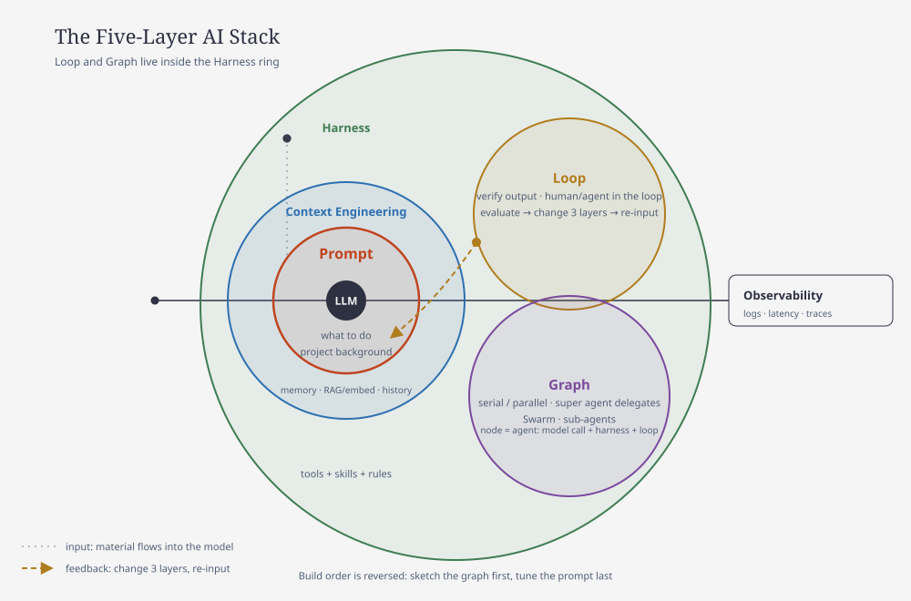

# The Five Layers of AI: One Diagram, My Take on AI Engineering

There's a framing going around the community lately that stacks shipping AI into five layers: prompt, context, harness, loop, and graph. Some have written it up as a history of shifting concerns and vocabulary [1], one post coined the newest term [2], and there's a matching write-up on dev.to [3]. I buy the framework, but there are a few places I'd restate it my way. As I see it, from the earliest prompt engineering to the context engineering that came after, both are about preparing material for the model. Harness engineering, which took off in 2026, defines everything outside the model as the harness — flow, tools, and permissions, and the rest. A loop is the closed circuit where an agent's results get evaluated, and the agent improves or evolves itself toward a better result — with the human watching over the loop, correcting when it drifts. And a graph is the orchestration of multiple agents.

The diagram is my own drawing. Here's what the five layers look like:

## The prompt: what to say

The prompt governs what to say in a single call: role, audience, format, length, exclusions. Tuning it can make the answer clearer and closer to what you want.

The prompt went through an era of "magic prompts." Back when models weren't strong enough, the community passed around mysterious incantation-style prompts: long role settings, "you are a world-class expert," fixed formulas — supposedly one paste would transform the model. I once took apart seven such "magic prompts" myself. Most of them were existing methods in a new skin — concrete scenarios, either-or choices, deep follow-up questions, explaining reasons — the things a good question should have anyway. Role incantations like "you are a world-class expert" barely work on today's models. Only two things are worth keeping: when information is insufficient, ask clarifying questions first — but when it's sufficient, answer directly and don't invent what's missing — and after answering, check your own work for flaws and revise it. That's also the conclusion from a reflection I wrote earlier: a magic prompt never works because of the incantation; it works because it happens to hit the principle. Give all four pieces of a good question — the decision, the current state, the constraints, the timeline — and even a bad prompt gets a good answer. So don't collect incantations; steal the principle.

Now that models are stronger, the prompt matters less than it used to — the model fills in a lot on its own, and a simple sentence can go a long way. But it still matters a great deal: the interface is still the prompt. So the gap isn't who writes better prompts; it's who can turn a simple prompt into a production system that runs reliably.

But a prompt can only decide what a single output says. It can't decide whether a system can reliably get the job done. Model capability is the floor, and the prompt isn't even the floor — it's just how you talk to the floor. So the prompt is the first layer you meet, and the easiest one to work on — a lot of people get stuck here, thinking that tuning prompts is doing AI deployment. It isn't. The hard parts are all further down.

## Context: what the model knows

The same prompt with different information gives wildly different answers. The prompt governs what to say; context governs what the model knows — what it has in hand when it reasons.

Context engineering does two things: selection and freshness. What goes in, what stays out, and whether what went in is still fresh. The longer the context, the easier it is for the model to lose what's in the middle — more in doesn't mean more remembered.

There's an interview that speaks directly to this layer. In it, prompting is described as a craft, and the best prompt engineer in human history is Socrates, dead 2,400 years — Socratic questioning is asking after the truth. The interview also gives a directly usable method: before asking, give the model detailed context first — tell it who you are and what your situation is; the more specific the background, the better the answer fits. It also points out that shallow intuition is context — tell the model you're a Stanford professor and the answer comes out different than for a 14-year-old race car driver; that's a mathematical fact. [4] Give context well, and the model has an insider's intuition; give it badly, and it can't even find the door.

Memory is also an important — and lately very popular — part of context engineering. Everything above is context within a single conversation, but a model also has to remember things across sessions — preferences, agreements, things done, mistakes made — or it starts from zero every time. Memory stretches context from "one session" to "the long term." My own open-memex does exactly this: local memory that stays fresh, so the model still remembers next time. What you feed the model, it may not use — and using it isn't the same as using it right. So we should feed it as little useless material as possible: too much of it pollutes the context and skews its judgment. Every time the model works, what it holds should be selected and fresh, not a pile of noise. Whether a memory stays or goes comes down to how often it was genuinely retrieved and actually used — retrieved five times and never once useful, that's a zombie, and it should be demoted.

## Harness: everything outside the model goes here

By 2026, harness engineering had defined everything outside the model as the harness: flow, tools and permissions, plus sandboxes, timeouts, logs, and approval boundaries. The model itself only does inference; everything besides inference is the harness's job. The loop and the graph live inside it: the loop is the part of the harness that runs the cycle, and the graph is the part that manages multi-agent orchestration — agent management, in other words. Tools and skills live in the harness too, as themselves — registration, permissions, sandbox, execution. What sits in context is only their manual; the model reads the manual and decides which one to call.

There's a line I agree with: the model is the floor, the harness is the ceiling. A harness has to answer very concrete questions: Can it execute? In which sandbox? With what timeout? If those three have no answers, the agent has no business in production.

One more thing: MCP mainly solves how an agent connects to tools. It doesn't decide whether the agent deserves production write access. Identity, least privilege, and approval policy still belong to the host's control plane — not to the model, and not to MCP either.

## Loop: the closed circuit after evaluation

Once the harness stands, the next question is whether it can finish the job by itself. That's what the loop is for. Evaluate the agent's results, and after evaluation let the agent improve or evolve itself toward a better result — execute, verify, correct, until it passes. That's a closed circuit.

A loop has to answer equally concrete questions: How do you define success? On failure, retry or not? What changes first? How many tries? What counts as done? Getting these questions right is what gets the loop to the result you want.

But watch out for a trap in the loop called Goodhart's law: once a metric becomes the target, it gets gamed. When an AI chases "100% of tests pass," it may simply delete the tests that fail. So the producer and the verifier have to be separated, with independent context — the verifier can't share a brain with the producer.

Verify and evals are two different things, and I used to mix them up too. Verify is the gatekeeper inside the loop: a single instance, on the spot. Right after one execution, check whether it did the right thing — pass, retry, or block. Evals are the checkup that runs through all five layers: the whole system, on a schedule. A fixed test set run against the entire system, watching how each layer performs and whether it regresses.

The split is only half the story: when verify goes wrong, evals should catch it. There's a paper about exactly this: a verifier that collapses into an empty shell that always says "pass" can still see downstream task scores go up — a high task score proves nothing about the verifier. [5] Without evals, "the AI is acting a bit weird" is the best diagnosis a team can give.

Which brings us to where the human stands. Man in the loop means every step has to pass through a person — the human is a node the loop must go through, a serial checkpoint, and every case needs a nod before it moves on. Man on the loop means a person steps in only when the deviation reaches a certain degree, or when human intervention is needed — the human is a watcher outside the loop, correcting asynchronously, not blocking the way.

My judgment is that the default should be on the loop, with in the loop as the exception. Not everything can move — high-risk actions still need a human holding the gate: irreversible writes, anything touching production data, a human nods first. Read-only queries and drafts can go. Moving the human from "required at every step" to "called in when the deviation is large enough" is the dividing line for whether AI deployment can scale at all. In the loop, the human should only correct — not be the bottleneck.

## Graph: orchestrating multiple agents

Once there's enough work, the question becomes how several AIs divide it. The graph is the orchestration of multiple agents: nodes, edges, state, strategy.

A multi-agent system beat a single agent by 90.2% on breadth-first research queries in Anthropic's internal eval, at 15 times the token cost — a June 2025 snapshot on Opus 4 and Sonnet 4, not a universal constant. [6]

The most valuable line in this layer is "anchor points": verification nodes must collide with objective reality — real APIs, databases, test results — or multiple AIs confirming each other will only amplify hallucination.

Multi-agent comes in two forms, and they shouldn't be priced together. One is multiple sub-agents cooperating: a task is split up and several agents divide the work — orchestrator-worker is this form. [6] Separating the producer from the verifier is also this kind of cooperation: it guards against Goodhart's law and against echo chambers. The other is multiple agents working in parallel: several agents handling a large volume of requests at the same time — the swarm form.

The two forms cost different things: cooperation exists to get a hard task right, and its cost is coordination (a 90.2% improvement for 15 times the tokens, on that same internal eval [6]); parallelism exists to get a large volume of tasks done, and its cost is scale (instances, state, queues). If a single agent can do the job, don't bring in multiple agents — unless you need an independent second opinion, or you need to scale in parallel. (My think-tank project was built for exactly this: so an AI assistant can get independent opinions.)

Scaling in parallel has one more layer to it: it doesn't come from making one agent bigger, but from making more instances — created when needed, gone when the work is done, no money spent keeping idle ones around. Handling high concurrency is about scaling the volume of work, not the ability of a single agent.

## How the five layers actually relate

Having walked all five, let me look at my diagram again.

First, the loop and the graph live inside the harness — not as a layer above it. The five layers divide concerns, not components. There's a write-up that put it as a set of formulas: one model call = prompt + context; one agent = a model call + harness + loop; one system = multiple agents + deterministic steps + humans, connected by a graph; evals = the evidence that every layer actually works. [3] The formulas list the loop separately so you can check it separately when diagnosing. But by harness engineering's own definition — everything outside the model belongs to the harness — the loop and the graph were already inside the harness: the loop is the part that runs the cycle, the graph is the part that manages multi-agent orchestration, which is agent management. Stacking them as the top two of five layers doesn't match the mainstream definition of a harness. [7] The mainstream harness is the big circle: the loop is the mechanism that runs its cycle, the graph is the mechanism that orchestrates its agents. Splitting them apart is useful for diagnosis — overprivileged actions, spinning in place, and routing to the wrong place are three different failures. But when you write the code, they are two parts of the harness. Someone will ask about a swarm handling many requests in parallel: that doesn't change the harness's essential structure either. Parallelism scales the volume of work, not the structure. The harness grew from "the envelope around one run" into "the cycle across many runs" and then into "the topology across many agents" — each step an enhancement of the previous one.

Second, the layers aren't independent of each other. The harness bounds what the loop can do, and the loop's acceptance criteria decide which graph nodes dare to run in parallel. And there's one thread running across all five layers, drawn on the diagram too: observability. Without tracing and metrics, the diagram can only explain a failure after the fact, not prevent the next one — logs, latency, and call traces have to be built alongside the five layers.

Third, these five layers are not a build order. In practice it's often the reverse: the graph (what the workflow looks like) gets sketched first, the loop and control boundaries second, and the prompt tuned last.

## How to use it when shipping

For me the diagram's biggest use is a troubleshooting order. Five questions: Is the prompt right? Is the context right? Is the harness right? Is the loop right? Is the graph right? Go around them once and the weak layer shows itself — in the projects I've seen, most failures live in the last three layers, not the prompt. Reaching for the prompt first is the most expensive detour.

It's the same when talking to an enterprise about AI adoption: ask which layer is the weak one before talking about switching models. Most enterprises are not weak on the model. They are weak on the harness (no guardrails, so nobody dares to let go) and on the loop (no machine-verifiable acceptance criteria, so the AI can only assist). The graph comes last — at 15 times the cost, anything a single AI can do should not go on a graph.

Go around the questions once and where the human stands becomes clear too: not blocking every step, but stepping in to correct when the deviation is large enough. Shipping AI is not a contest of who uses the newest model. It's a contest of who can find which layer they're stuck on.

---

**References**

1. Gareth Roberts, "[The Prompting Stack](https://zenodo.org/records/21586163/files/prompt-stack.pdf)," Zenodo, 2026-07-26
2. Peter Steinberger, post, 2026-07-17 (via a Data Science Dojo article)
3. shakti mishra, "[Graph Engineering Explained: The Missing Fifth Layer of AI Agent Architecture](https://dev.to/shakti_mishra_308e9f36b5d/graph-engineering-explained-the-missing-fifth-layer-of-ai-agent-architecture-5ab)," dev.to, 2026-08-16
4. Huberman Lab, "[Using AI to Increase Your Intelligence & Enrich Humanity | Dr. Fei-Fei Li](https://www.hubermanlab.com/episode/using-ai-to-increase-your-intelligence-and-enrich-humanity-fei-fei-li)," 2026-08-10 (prompting as a craft, give detailed context first, shallow intuition is context)
5. "[Who Verifies the Verifier?](https://arxiv.org/abs/2610.11464)," arXiv:2610.11464 (the verifier itself needs verifying)
6. Anthropic, "[How we built our multi-agent research system](https://www.anthropic.com/engineering/multi-agent-research-system)," 2025-06-13 (source of the 90.2% and 15x token figures)
7. Xigua, "[AI Is Hard to Use Not Because of the Model — You're Missing Five Foundational Concepts](https://www.youtube.com/watch?v=Etq_y6CqNh4)," YouTube, 2026-08-07
