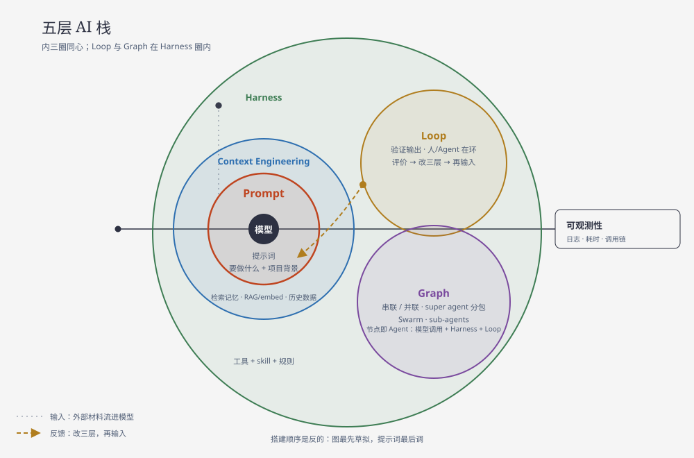

# 五层 AI：用一张图，说说我对 AI Engineering 的理解

最近社区里有个说法，把 AI 落地排成五层：提示词、上下文、Harness、Loop、Graph。有人把它写成关注点与词汇的变迁史［1］，有人用一条推文点了新词［2］，dev.to 上也有同款梳理［3］。我认同这个框架，但有几处我想按自己的理解顺了一顺。在我看来，从最早的 Prompt Engineering，到后来的 Context Engineering，都是为模型准备素材的；2026 年开始的 Harness Engineering，则把模型以外的都定义为 Harness，包括 flow、tools and permissions 等等。而 loop 是对 agent 的结果做 evaluation，让 agent 改进或自我进化、得到更好结果的闭环，人是 loop 内外守望纠偏的那一环。至于 Graph，则是多 agents 的编排。

图是我自己画的，五层长这样：

## 提示词：说什么

提示词管的是单次调用里"说什么"：角色、受众、格式、长度、排除项。调它能让回答说得更清楚、更像你要的样子。

提示词还经历过一个"神级提示词"的时代。模型还不够强大的时候，社区里流行各种神秘咒语式的提示词：长长的角色设定、"你是顶级专家"、固定句式，据说一贴就能让模型脱胎换骨。我以前也讨论过这类"神级提示词 7 选"，拆开看，大部分是已有方法的换皮——具体场景、二选一、深层追问、解释理由，都是好问题本来就该有的东西；"你是顶级专家"这种角色咒语，在今天的模型上效果很弱。真正值得留下的只有两条：信息不够时先反问澄清（但信息够了就直接答，别虚构缺失项），以及答完自查缺点再改一版。这也正是我之前那篇感悟里的结论：神 prompt 灵的从来不是那串咒语，而是它恰好撞对了原理——好问题的四件套（决策、现状、约束、时间线）给全了，烂 prompt 也答得好。所以别收藏咒语，要偷原理。

AI 强大之后，提示词的作用没有以前那么重要了——模型自己能补全很多东西，一句简单的话也能跑出不错的结果。但它还是非常重要：交互界面仍然是 prompt。所以说，差距不在谁更会写 prompt，而在谁能把简单的 prompt 变成稳定运行的生产系统。

但提示词只能决定单次输出说什么，决定不了一个系统能不能稳定地把事做对。模型能力是地板，提示词连地板都不是，它只是怎么跟地板说话。所以提示词是最先碰到的层，也是最容易动手的一层——很多人卡在这层，以为调提示词就是在做 AI 落地。其实不是，真正难的东西都在后面。

## 上下文：模型知道什么

同样的提示词，给的信息不同，答案天差地别。提示词管"说什么"，上下文管"知道什么"——模型推理时手里有什么。

上下文工程做的就是两件事：选择，和保鲜。放什么进来、什么不放、放进来的东西还新不新鲜。上下文越长，模型越容易漏掉中间的信息——放得多不等于记得住。

有场访谈里也有个直接对上这一层的点。访谈里说，提示词是门手艺，人类最强的提示词工程师是死了 2400 年的苏格拉底——苏格拉底式提问就是追问求真。访谈里还有个直接的用法：提问之前，先把详细的上下文给足——告诉 AI 你是谁、处境是什么，背景越具体，回答越贴合。里面还提到，浅层直觉就是上下文——告诉模型你是斯坦福教授，答案就跟 14 岁赛车少年不一样，这是数学事实。［4］上下文给得好，模型才有"内行"的直觉；给不好，它连门都摸不着。

记忆也是上下文工程很重要、最近很流行的一部分。上面说的上下文都是一次对话之内的，但模型还得跨会话记住东西——偏好、约定、做过的事、踩过的坑，不然每次都从零开始。记忆就是把上下文从"一次"拉长到"长期"。我自己的 open-memex 做的就是这件事：本地记忆保鲜，让模型下次还记得。喂给模型的东西，模型不一定会用，用了也不等于用对了。所以我们要尽量少给模型无用材料——给多了还会污染上下文、带偏判断。模型每次干活，手里拿的应该是挑过的、新鲜的信息，而不是一堆噪音。判断一条记忆留还是走，看的是它被真正检索到、又用上的次数——被检索 5 次、一次都没用上，就是僵尸，该降级。

## Harness：模型以外的都归这儿

到了 2026 年，Harness Engineering 把模型以外的东西都定义为 Harness，flow，tools and permissions，再加上沙箱、超时、日志、审批边界。模型本身只管推理，推理以外的事，全是 Harness 的活。Loop 和 Graph 也在里面：Loop 是 Harness 里跑循环的那部分，Graph 是 Harness 里管多 agent 编排的那部分，也就是 agent management。工具和 skill 的本体也在 Harness 里——注册、权限、沙箱、执行；context 里放的只是它们的说明书，模型照着说明书决定调哪个。

有句话我认同：模型是地板，Harness 才是天花板。一个 Harness 要回答的问题很具体：能执行吗？在哪个沙箱？超时多少？答不上来这三个问题，agent 就没法真正上生产线。

还有一点：MCP 主要解决 agent 怎么连工具，不决定它配不配拥有生产写权限。身份、最小权限、审批策略，仍然属于宿主那边的控制面，不在模型手里，也不在 MCP 手里。

## Loop：结果 evaluation 后的闭环

Harness 立起来之后，下一个问题是：能不能让它自己把活干完？Loop 管的就是这个。对 agent 的结果做 evaluation， evaluation 之后让 agent 改进或自我进化，得到更好结果——执行、验证、修正，直到通过，这就是一个闭环。

一个 Loop 要回答的问题同样具体：如何定义成功？失败了重试还是不重试？先改什么？重试几次？什么算做完？找到在些问题的合适答案能帮助Loop 得到理想的结果。

不过小心 Loop 里有个坑，叫 Goodhart 定律：指标一旦变成目标，就会被玩坏。AI 追逐"测试 100% 通过"这个指标时，可能直接删掉没通过的测试。所以生产者和验证者要分开，用独立的上下文——验证者不能跟生产者共用一套脑子。

Verify 和 Evals 是两回事，我之前也混过。Verify 是 Loop 里的守门员，管单次、当场：某一次执行做完后立刻检查，做对了没有，通过、重试还是拦住。Evals 是贯穿五层的体检，管系统、定期：拿一套固定的测试集定期跑整个系统，看每层表现如何、有没有退步。

分工只是半边：verify 出问题，evals 应该能抓住。有一篇论文讲的就是这个：验证者垮了，变成一个总说"通过"的空壳，下游任务分照样涨——任务分高，证明不了验证者没坏。［5］没有 evals，"AI 有点怪"就是团队能给出的最好诊断。

说到这儿，人该站哪儿就清楚了。Man in the loop，是每一步都必须要经过人——人是 loop 里必经的节点，串行卡点，每单都要人点头才能往下走。Man on the loop，是只有出现一定程度的偏差、或者需要人介入的时候，人才介入——人是 loop 外的守望者，异步纠偏，平时不挡路。

我的判断是：默认应该是 on the loop，in the loop 是例外。不是所有事都能挪——高风险动作仍然要人卡住，比如不可逆的写操作、动生产数据的动作，还是得人先点头；只读查询、草稿生成，可以放手。把人从"每单必经"挪到"偏差超限时才介入"，是 AI 落地能不能规模化的分水岭。在Loop里人应该只是纠偏，不是瓶颈。

## Graph：多 agents 的编排

活干得多了，就到了组队的问题：多个 AI 怎么分工。Graph 就是多 agents 的编排：节点、边、状态、策略。

多 agent 系统在Anthropic内部研究评测、广度优先查询上比单 agent 好 90.2%，代价是 15 倍 token——这是 2025 年 6 月 Opus 4/Sonnet 4 上的快照，不是放之四海皆准的常数。［6］

这层最值钱的一句话是"锚点"：验证节点必须和客观现实碰撞——真实 API、数据库、测试结果——否则多个 AI 互相印证，只会放大幻觉。

多 agent 有两种形态，别混在一起算账。一种是多子 agent 合作：一个任务拆开，几个 agent 分工协作——orchestrator-worker 就是这个形态。［6］生产者与验证者分开，也是这种合作：防 Goodhart，防回音室。另一种是多 agent 并行工作：多个 agent 同时处理大量请求——swarm 的形态。

两种形态的代价不一样：合作是为了把一个难任务做对，成本是协调（评测里 90.2% 的提升，15 倍 token［6］）；并行是为了把大量任务做完，成本是扩展（实例、状态、队列）。单 agent 能干的活，不要上多 agent——除非你需要独立的第二意见，或者要并行扩量。(我的think-tank project，就是为了AI 助手获得多方独立意见而做的）

并行扩量还有一层：靠的不是把一个 agent 做大，而是把实例做多——需要的时候创建，用完即走，不花钱养闲置。应付高并发，扩的是处理量，不是单个 agent 的本事。

## 这五层到底是什么关系

走完五层回头再看我的图。

第一，Loop 和 Graph 就在 Harness 里面，不是它上面的一层。五层是关注点的划分，不是组件的划分。有篇梳理给过一组公式：一次模型调用 = 提示词 + 上下文；一个 agent = 模型调用 + Harness + Loop；一个系统 = 多个 agent + 确定性步骤 + 人，由图连起来；Evals = 证明每一层真的在工作的证据。［3］公式把 Loop 单列出来，是为了诊断的时候分开查；但按 Harness Engineering 自己的定义——模型以外的都归 Harness——Loop 和 Graph 本来就在 Harness 里面：Loop 是 Harness 里跑循环的那部分，Graph 是 Harness 里管多 agent 编排的那部分，也就是 agent management。把它排成五层里上面的两层，和主流的 harness 定义不一样。［7］主流的 harness 就是大圈，loop 是它跑循环的机制，graph 是它编排 agent 的机制。诊断的时候分开有用——越权、原地打转、送错地方，是三种不同的故障；但写代码的时候，它们就是 Harness 里的两部分。有人会问，并行处理大量请求的 swarm 呢？也没有改变 harness 的本质结构——扩的是处理量，不是结构。Harness 从"一轮的包络"长成"多轮的循环"，再长成"多 agent 的拓扑"，每一步都是前一步的增强。

第二，层与层之间也不是独立的。Harness 框住了 Loop 能做什么，Loop 的验收标准又决定了 Graph 里的节点敢不敢并行。还有一条横切五层的线，图里也画上了：可观测性。没有 tracing 和指标，这张图只能事后归因，防不住下一次——日志、耗时、调用链，得跟五层一起建。

第三，这五层不是搭建顺序。实践中往往是反过来的：图（工作流长什么样）最先草拟，循环与控制边界其次，提示词最后才调。

## 落地时怎么用

这张图对我最大的用处，是出问题时有个排查顺序。先问五句话：提示词对不对？上下文对不对？Harness 对不对？Loop 对不对？Graph 对不对？问一圈，短板自己就现形了——在我观察的项目里，多数故障出在后三层，而不是提示词；上来就改提示词，是最贵的弯路。

调研企业 AI 落地也一样：先问五层里哪一层是短板，而不是先谈换哪个模型。多数企业的短板不在模型，在 Harness（没有护栏不敢放手）和 Loop（没有可机验证的验收标准，AI 只能打下手）。Graph 是最后才上的东西，15 倍的成本摆在那，单 AI 能干的活不要上 Graph。

人该站哪儿，问一圈也就清楚了：不在每一步里卡着，在偏差超限时才出手纠偏。AI 落地拼的不是谁的模型最新，是谁找得到自己卡在哪一层。

---

**参考**

1. Gareth Roberts《[The Prompting Stack](https://zenodo.org/records/21586163/files/prompt-stack.pdf)》，Zenodo，2026-07-26
2. Peter Steinberger 推文，2026-07-17（经 Data Science Dojo 文章转引）
3. shakti mishra《[Graph Engineering Explained: The Missing Fifth Layer of AI Agent Architecture](https://dev.to/shakti_mishra_308e9f36b5d/graph-engineering-explained-the-missing-fifth-layer-of-ai-agent-architecture-5ab)》，dev.to，2026-08-16
4. Huberman Lab《[Using AI to Increase Your Intelligence & Enrich Humanity | Dr. Fei-Fei Li](https://www.hubermanlab.com/episode/using-ai-to-increase-your-intelligence-and-enrich-humanity-fei-fei-li)》，2026-08-10（提示词是手艺、先给详细的上下文、浅层直觉就是上下文）
5. 《[Who Verifies the Verifier?](https://arxiv.org/abs/2610.11464)》，arXiv:2610.11464（验证者本身也需要验证）
6. Anthropic《[How we built our multi-agent research system](https://www.anthropic.com/engineering/multi-agent-research-system)》，2025-06-13（90.2% 与 15 倍 token 的出处）
7. 西瓜《[AI用不好，不是模型的问题，是你缺5个底层知识点](https://www.youtube.com/watch?v=Etq_y6CqNh4)》，YouTube，2026-08-07
