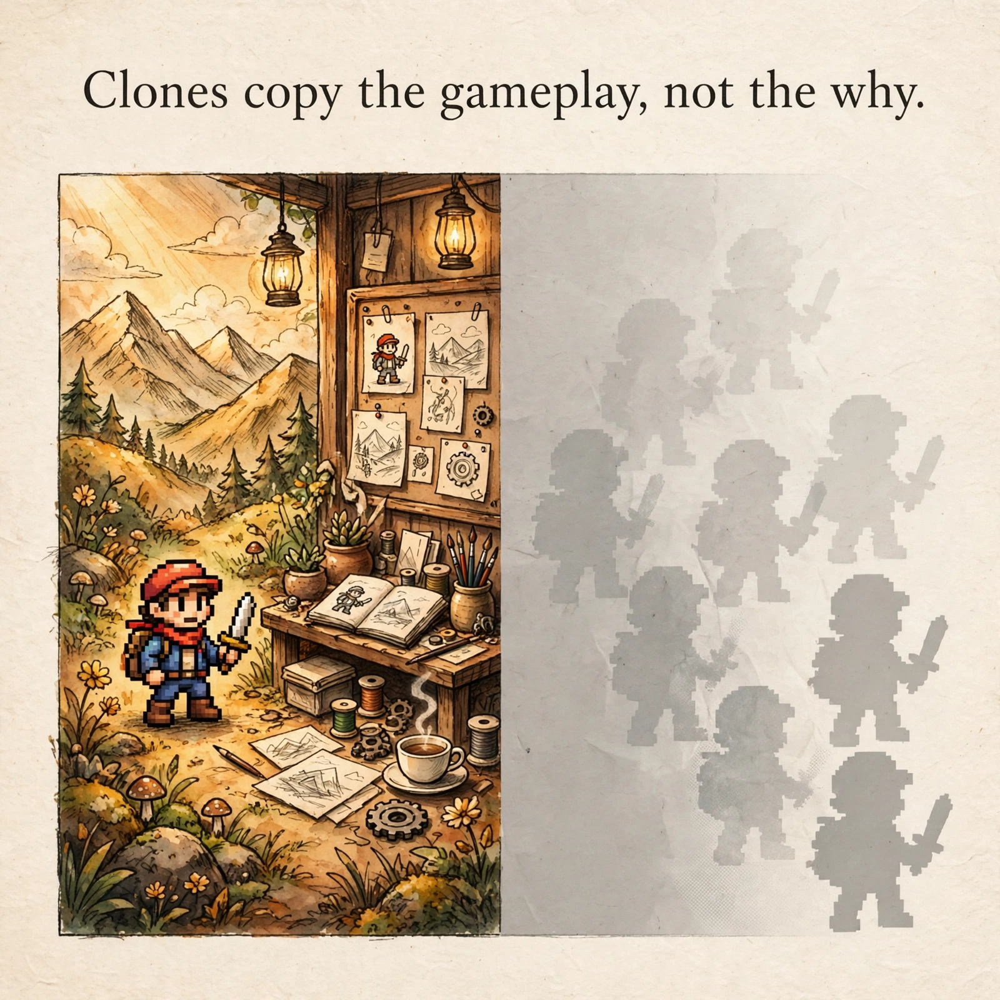

# 32. 仿制品抄得到玩法，抄不到你为什么这样做（2026-10-26）

[← 返回目录](./index.md) · [English Version](./32-clones-can-copy-the-gameplay-not-why-you-made-it-this-way-en.md)

---

看到 Steam 新品节（Steam Next Fest）2026 年 10 月场的新闻，我第一反应也是心凉：七千多个 Demo，一款游戏还没上市，玩法视频一走红，几天内 Roblox 上就冒出十来个仿作，换个皮就能上架收钱。AI 把“看懂再复刻”的时间从几周压到了几天，独立制作者好像刚露头就被抢了。

但把几个案例一个个核对下来，我发现我一开始打错了敌人。所谓“被抄”，其实是三件不同的事混在了一起。

第一件是机制被干净地重写。这件事拦不住，从游戏诞生起就拦不住，AI 只是让它变快了。一个点子一旦公开，就不再是你的私产，能留住的只是你把它做出来的那个版本。

第二件是素材和代码被原样搬走。这件恰恰能拦，而且最该在事前拦：别把还没做完的东西打包进公开 Demo，别把关键逻辑全放在客户端，平时留好带时间戳的创作记录。被搬走原样的时候，平台投诉是管用的，怕就怕你自己先把门打开了。

第三件最容易被忽略，也最要命：不是被抄死的，是没被看见死的。七千多个 Demo 摆在一起，玩家根本翻不过来，好作品也可能沉下去。仿制只是加速了竞争，发现本身已经成了新的瓶颈。

所以护城河从来不在代码那一行。代码是游戏里最便宜的一环，AI 再快，也只是在便宜的东西上更快。真正贵的东西，仿制品拿不到：跳跃的手感是几百次试玩磨出来的，难度曲线是改了又改改出来的，一套美术风格为什么是这个颜色、这个角色为什么停在这里、这个故事为什么在这个地方收住，这些“为什么”才是品味。

对做美术、做游戏的人来说，这句话可能更直接：风格可以被学走，但一整套选择不能被一次抄走。AI 能画一张像你的图，画不出一整个世界为什么是这样；能抄一个机制，抄不到你为什么在这个机制后面又加了这一层内容、这一段叙事、这一次更新。

AI 把生产变便宜了，反而让“为什么”变贵了。以前靠一个好点子加一个 Demo 就能出头的时代，确实在结束。接下来的时代，值钱的是把点子做到底、做厚、做连续的能力，还有让人愿意跟你走下去的信任。仿制品能做到“看起来像”，做不到“做下去”。

这不是创意死了，是创意换了个位置：从“想出来”，移到了“做出来、做下去、让人信”。对真正做东西的人来说，这反而是好消息，因为后者是抄不走的。

Source: [Steam Next Fest Has Become A Massive Disaster And A Grim Look At The Future](https://kotaku.com/steam-next-fest-has-become-a-massive-disaster-and-a-grim-look-at-the-future-2000748008)
