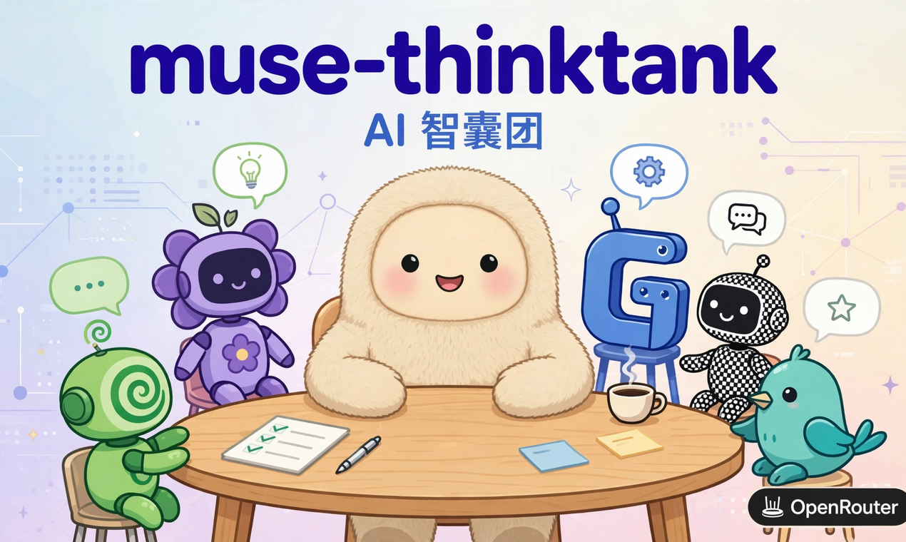

# 我给 Muse 写了个智囊团

[← 返回首页](../index.md)

*2026-10-14 · [English Version](./i-built-muse-a-think-tank-en.md)*

我想出了一个让我的 AI 助理 Muse 更加强大的办法：给它加一个由不同家族 AI 构成的智囊团。

Meta Muse 是现在很火的 AI 个人助理，它让不懂编程的普通人也能用上真正能干活的 AI agent。但 Muse 自带的模型不够强大，单一模型的输出再流畅也有局限。

接入其他 AI 的 API 是很自然想到的办法，但既然能接入一个，为什么不可以接入多个、让它们一起发挥作用呢？多智能体辩论不是新东西，但支持它的基本都是第三方工具，而且只有少数高阶用户才知道用。Muse 自己没有这个功能——所以我建了 muse-thinktank，让 Muse 能调用 Claude、GPT、Gemini 等其他供应商的强模型，让它们互相质疑、辩论、迭代。Muse 通过一个 Agent Skill 来调用它——skill 就是告诉 agent 什么时候、怎么跑这场辩论的操作手册。这个 skill 不绑定 Muse，任何 AI agent 都能用，只不过我是为 Muse 打造、在 Muse 里测试的。普通用户不用写一行代码，就能用上以前只有高阶用户才玩得转的方法。

它解决的是当前 AI 的一个真问题：你问一个 AI 问题，它答得斩钉截铁、格式漂亮——但可能是错的。不是明显错，是那种"你不事先知道答案就发现不了"的错。但当你把同一个问题问两个不同的模型，它们意见一致时几乎总是对的；它们分歧时，至少有一个错了——而分歧点正好告诉你该往哪看。

效果也很实在：不同的 agent 经常从不同角度找到不同的 bug。PR 评审时，一个模型抓逻辑错误，另一个抓边界条件，第三个挑设计问题。它们互相挑刺，我看的是分歧点。

开发过程里，我自然地用智囊团来审它自己的代码——自己的工具自己先用，天经地义。

但多模型辩论带来一个新问题：它们给出互相矛盾的答案时，谁来拍板？这就是人的位置。

很多次，AI 的输出技术上没错，但我凭直觉就觉得方向不对。我说不清具体哪一行错了，但那种"不对劲"的感觉非常真实。比如 v0.8 的切块方案跑通了，我看着就觉得"上下文不完整，结论不可靠"——后来深挖果然发现丢了跨文件视野。AI 感觉不到这个。

品味也一样。这篇文章的第一稿是 AI 写的，我直接整个推倒重来——不是改几句，是换切入点、换结构、换标题。AI 写得"正确"，但味道不对。

方向、品味、优先级——这些得人来定。AI 负责执行和辩论，人负责在分歧中做决定。

工具可以堆叠，但直觉与灵感无法外包。AI 不能代替我洗澡时的灵光一闪，不能代替我面对一堆正确的说明书和陈词滥调时的大皱眉头，更不能代替我对看似完美的解决方案说不。

项目地址：https://github.com/stoneskin/muse-thinktank

---