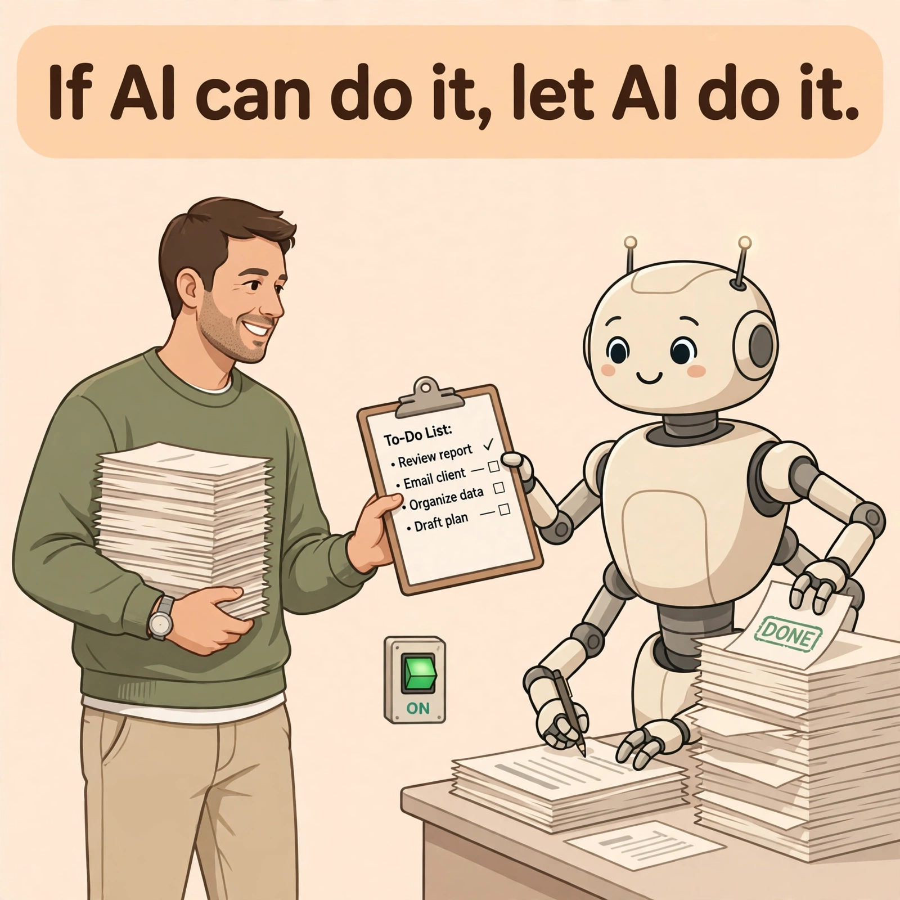

# 如果 AI 能干，就让 AI 干

[← 返回首页](../index.md)

*2026-10-31 · [English Version](./if-ai-can-do-it-en.md)*

前几天在 X 上看到一条推，大意是：天天泡在 X、GitHub 和 AI 社区的人，对整个社会 AI 的普及程度可能有严重误判。我们每天看到新模型、Agent 写代码、几十个 Skill 协作，觉得这些东西不是早就普及了吗？走进一家传统企业才发现，根本不是这么回事。

我看完第一反应是：他说的这个误判，我每天都在身边看到。普通人圈里对 AI 抗拒的人很多，技术圈子里不接受 AI 的也不少。很多人不是不想用，是想用又怕，或者不知道从哪开始。试过几次，回答不准、活儿干不完，就得出结论：AI 也就那样。

有时候我会觉得自己和周围的人有点脱节。不是谁对谁错，是用 AI 的方式不一样。他们想的是：我能用 AI 干干什么？把 AI 当成一个工具箱，遇到事翻一翻，看看哪件工具能用上。我想的是反过来的：如果这件事 AI 能干，就让 AI 去干。先默认它能干，再看它干得怎么样，不行我再接手。

这两句话听起来差不多，其实差了一整层。第一种问法里，人是干活的，AI 是帮忙的；第二种问法里，AI 是干活的，人是把关的。我是后一种用习惯了，时间长了就变成了一种思维：事情先过一遍 AI 的手，我只负责方向、拍板和纠偏。

那条推里举了个例子，有人在线下教企业员工用 AI，教的只是一个小技巧：需求说不清楚的时候，让 AI 主动提问，帮你把需求梳理清楚。在技术社区里这根本不值得讨论，但对普通用户来说，已经足够改变使用体验。我觉得这个例子点出了关键：挡住大多数人的不是 AI 不够强，是不知道从哪一步开始把活儿交出去。

所以真正的差距可能不是会不会用某个工具，而是愿不愿意把事情交出去。交出去要冒两个险：一个是 AI 干砸了怎么办，一个是交出去之后我干什么。第一个有办法：先从小事交、从能检查的交，干砸了再拿回来。第二个才是难的：很多人不是离不开干活，是不知道不干活的时候自己该干什么。

这也是我觉得窗口期还在的原因。真正的业务世界，可能连第一轮 AI 改造都还没开始。机会不是去跟别人讲多 Agent 编排、Context Engineering 这种词，而是拿对方手里一份真实的文件，现场把一个繁琐的流程跑出来。看得见，才信得过。

当然，脱节是双向的。他们活在“AI 也就那样”的茧房里，我也活在自己的茧房里，一个重度用户的茧房，在里面觉得“这还用说吗”。那句话其实也是写给我看的：不能永远待在技术社区里，得走出去，看看别人每天到底在为什么事情头疼。不然我连“别人需要什么”都是猜的。

别人问“我能用 AI 干什么”，我问“这件事为什么还要我干”。中间差的不是一个工具，是一个默认设置。把默认设置改过来，窗口期才真正是你的。

Source: [X 上的一条推](https://x.com/UPing123zzz/status/2116014024747876656)
