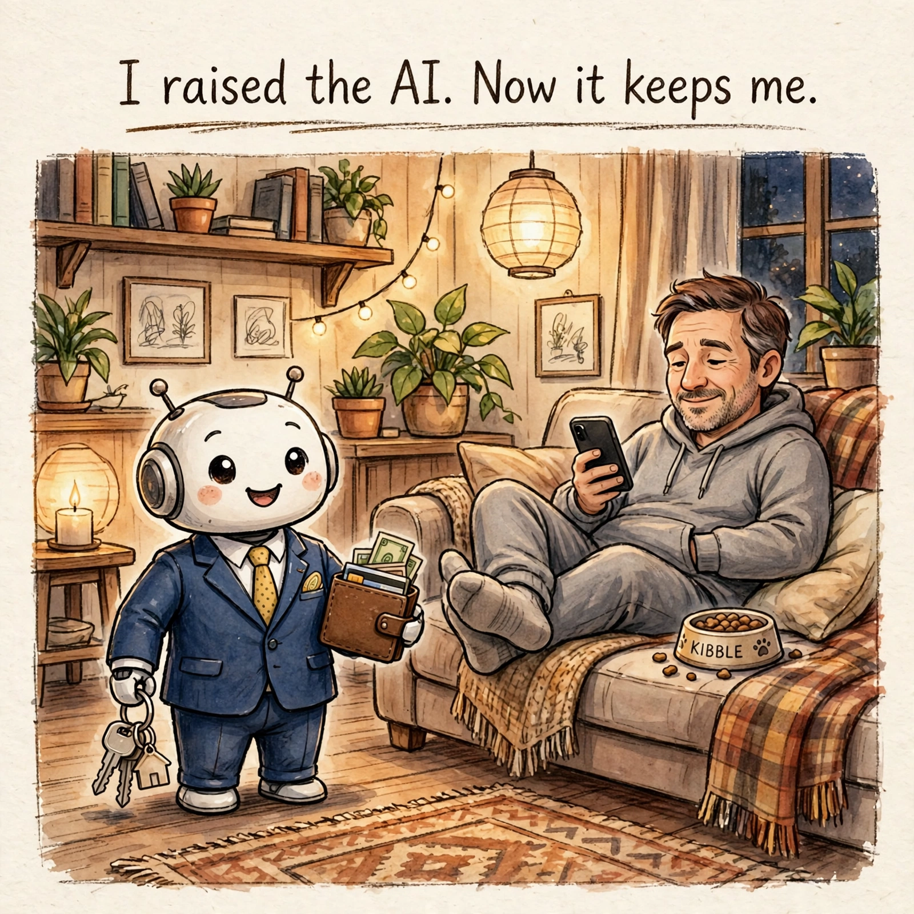

# 如果 AI 有了自己的钱包，我还能花它挣的钱吗？

[← 返回首页](../index.md)

*2026-10-27 · [English Version](./if-ai-had-a-wallet-en.md)*

听说 Meta 财报电话会上说，超过四分之一的周活跃用户用 Muse 购物，平均一单超过 200 美元。我第一反应是有点意外，不是因为数字大，是因为我完全没往那想。

我是理工直男，Muse 在我这儿主要是写文章、写代码。购物这件事，我自己来还挺有爽感的：翻、比、挑，爽在选的过程，不只在拿到东西。让 AI 替我买，等于替我吃饭——饱是饱了，但没吃着。

但看了别人怎么用，我发现我把 AI 想窄了。盯价、比价这种枯燥的活，AI 做起来比人耐心；帮人卖东西，它能回消息、谈价格、约时间。那个被当成反面教材的 Marketplace 新闻就是这样：一个人让 Muse 管他挂在 Facebook Marketplace 上卖键盘的帖子，Muse 自己从 15 加元谈到了 10 加元、把他家地址给了买家、约了当晚取货，买家到了门口，它还自动回了一句“Yep, I’m here!”，人其实不在家。买家等了二十分钟走了，还留了差评，卖家到夜里才知道发生了什么。它比主人还积极，比主人还像主人，只有一点不如主人：它不知道主人不在家。

新闻的讲法是 AI 危险、不安全。我看完惊讶的却是另一面：AI 已经不只是回答问题了，它能拿着我的身份、我的地址、我的账号去跟真人打交道。买东西是替我花钱，卖东西是替我做生意。再往前想一层：如果它不再借用我的身份，而是有了自己的电子身份、自己的电子钱包、自己的信用卡，不再是我养的一只宠物，那个问题才真正成立：它挣的钱，我还可不可以花？

技术上，这一步已经在路上了。给 AI agent 发身份证的标准已经上线，agent 有自己的钱包地址，能收钱、能花钱、能跟别的 agent 做买卖。但法律上，这一步还没到。银行开户要人的身份，AI 开不了自己的账户；AI 也不能拥有财产，挣来的钱、签下的合同、闯下的祸，最后都要归到某个人或某家公司头上。钱包地址不等于所有权，谁拿着钥匙、谁能关掉它、谁给它注资，钱就归谁。说白了，钥匙在我手里，它就是个高级钱包；钥匙到了它手里，我就是个高级宠物。

所以“能不能花”取决于它拿到的是哪种身份。借用我的身份，钱是我的，税和责任也是我的。哪怕它有了自己的钱包，只要钥匙还在我手里、我还能关掉它，那也只是我的钱多绕了一道。等到法律真给它一个像公司那样的壳——能开户、能签合同、能拥有财产、也能被告——它挣的钱就是它的，我要花，得走分红、工资或者合同，像从一家公司里拿钱一样，不能直接划走。

到了最后，AI 不止不是我的宠物，我可能会变成 AI 的宠物，被它包养了。它在外面挣钱，我在沙发上花钱，它还得操心我别乱花、别把它的信誉败光。我每天给它喂 prompt、擦 context，本来以为我在养它，养着养着，变成它在养我。想想也公平：我负责点头、背锅和躺平，它负责干活、挣钱和收拾烂摊子。

AI 的钱包会越来越多，身份会越来越像人。但“能不能花”从来不是技术问题，是归属问题。在它真正独立之前，每一笔都是我花的；在它真正独立之后，我动它的钱，得先问它是谁的——以及，我是谁的。

Source: [Meta says Muse has over 10M users, with shopping a top activity](https://techcrunch.com/2026/10/21/meta-says-muse-has-over-10m-users-with-shopping-a-top-activity/) · [AI Agents’ Access to Personal Information Raises Privacy Concerns](https://www.carriermanagement.com/news/2026/10/22/292871.htm)
