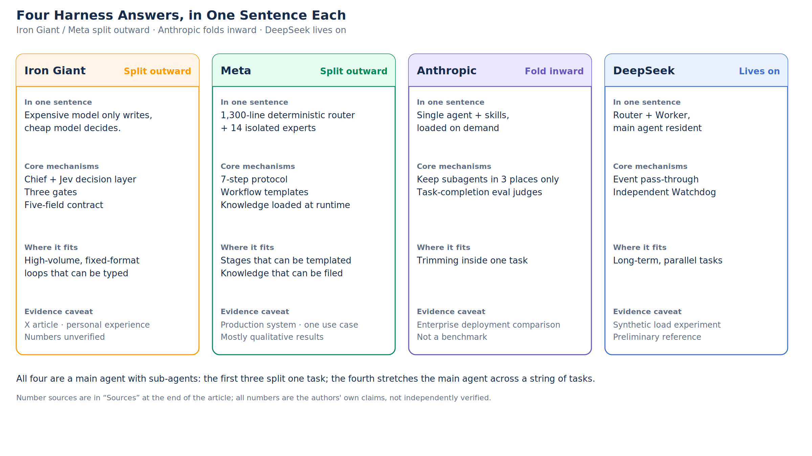
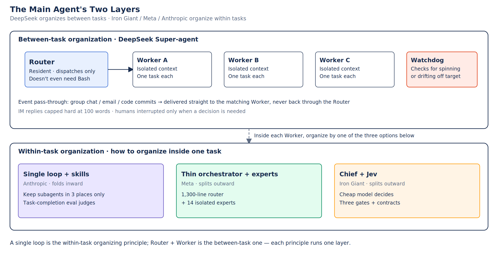
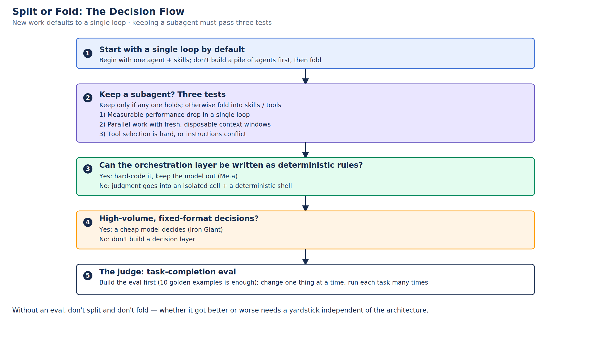

# Split or Fold? Four First-Hand Harness Notes Compared

[← Back to index](index.html) · [中文版](./harness-comparison.md)

You're building an agent system. The first architecture question arrives fast: split it into multiple agents, or let one agent do the whole job?

Over the past while, I read four design notes from front-line teams side by side — Iron Giant's Grok Bot in production, Meta's Thin Orchestrator, Anthropic's folding subagents, and DeepSeek's Super-agent. They all answer the same question: with one main agent and a group of sub-agents, how is the work divided, and who calls the shots? The four notes give different answers, but the disagreement isn't about whether to have a main/sub-agent structure — all four have one. It's about how thin the main agent should be, how many sub-agents to keep, and how long the main agent lives.

## Four Answers, in One Sentence Each

- **Iron Giant: split outward.** The expensive model only writes; the cheap model decides; the harness enforces; the swarm scales. One expensive model handling writing, routing, judgment, approval, and self-check is why it gets slow, expensive, and weird at 3 a.m. The way out isn't a stronger model — it's layers.
- **Meta: split outward, but keep the orchestration layer dumb enough.** A 1,300-line deterministic router doing zero domain work, only intent classification, field collection, reliability checks, and delegation; all domain reasoning goes down to 14 context-isolated expert sub-agents. Nobody sees the whole picture — that's a feature, not a bug.
- **Anthropic: fold inward.** A single agent + skills loaded on demand; keep sub-agents in only three places, fold the rest one at a time and let evals do the talking. Across enterprise deployments, the single loop often beats both "one prompt does everything" and "many sub-agents".
- **DeepSeek: also a main agent with sub-agents, but the main agent lives on.** Super-agent = a resident Router + isolated Workers: the Router only dispatches, each Worker does its own job. The Router doesn't dissolve when a task ends; it keeps running a set of parallel tasks, with event pass-through and a Watchdog. The bottleneck isn't the model, it's human attention — one person can follow at most 3–5 active sessions at once.

## Four Points They All Agree On First

Before the disagreements, here is what all four agree on — these four points are the floor, and the disagreements are built on top of it.

**First, the root cause is architecture, not the model.** None of the four bets on swapping in a stronger model: Iron Giant says the way out is layers; Meta says "this is not a prompt engineering problem, it's an architecture problem"; Anthropic says the single loop beats multi-agent designs because of structure, not the model; DeepSeek's bottleneck is human attention, and the fix is structural too — Router + Worker + Watchdog — not waiting for a stronger model.

**Second, context is the scarce resource, and managing it is the harness's main job.** Iron Giant replaces chat with files; Meta uses isolation to prevent contamination; Anthropic uses progressive disclosure to prevent bloat — the agent only sees short descriptions of skills and tools, and loads the full text only when needed; DeepSeek's Workers are likewise context-isolated, one task each.

**Third, as models get stronger, the harness must give way.** Anthropic puts it most bluntly: "each new model generation moves more decisions from the harness back into the model's hands", and a rigid multi-agent structure would only stop a new model from doing more. Iron Giant's Friday audit — tighten one rule, retire one bot — is the same discipline in another form; Meta's layers evolving independently, and DeepSeek's Router deliberately not depending on model capability (it doesn't even need Bash), are the same discipline: don't weld the harness to one generation of models.

**Fourth, measurement decides; feelings don't.** Iron Giant has thresholds and a Friday audit; Meta has a 7-step protocol and a reliability gate before delegation; Anthropic makes task-completion eval the only judge — build the eval first, change one thing at a time, don't just look at the total score, look at which tasks flipped; DeepSeek measures with synthetic-load experiments and has the Watchdog patrol for drift.

## The Real Disagreement: Split or Fold

Under the consensus, the disagreement is directly opposed. Iron Giant and Meta split outward; Anthropic folds inward.

Anthropic offers the only hard test for this argument: **new work defaults to a single loop, and keeping a sub-agent must pass three tests** — a measurable performance drop in the single loop from context bloat; parallel work that needs fresh, disposable context windows; tool selection that's difficult for one agent, or conflicting instructions in the system prompt. If you can't point to one, fold it into skills and tools.

Note that these three are tests for *keeping* a sub-agent, not reasons to *build* one. Many teams' agent architectures grow to look like their org chart — every capability belongs to a team, every team builds a sub-agent, and an orchestrator sits on top. Anthropic's five failure modes are worth checking one by one: information lost in context handoffs, sub-agent sprawl, Frankenprompts (each team adds a line to the system prompt and they conflict), local evals that each mind their own business, and latency. Every extra handoff is one more round of information loss.

DeepSeek also stands on the "split" side — Router + Worker is itself a split into a main agent and sub-agents. The split-or-fold question comes up again inside it: within each Worker, how one task is organized still has to be chosen among a single loop, a thin orchestrator, and Chief + Jev (see Figure 2). So split-or-fold isn't a one-time binary choice; it's a trade-off that repeats at every layer.

Once the split-or-fold direction is set, the next question is: who manages the experts that were split out?

## Governing the Experts: Contracts, Structure, Ownership, Lifespan

The four notes give four different answers to "how do you govern experts":

- **Iron Giant governs by contract**: a five-field contract per bot — job, sources, judgment, output, forbidden. It doesn't care how an expert grows inside; it only cares what contract it keeps on the outside. One line alone is worth the price of admission: "If you can't fill in the forbidden list, the role isn't thought through yet."
- **Meta governs by structure**: every sub-agent has the same structure — knowledge sources, required inputs, execution steps, and error handling, all in the same four-part shape; knowledge loads at runtime, so updates take effect immediately. It doesn't care what an expert knows; it only cares that it's built the same way.
- **Anthropic governs by ownership**: each team owns its skills and tools, and a small central team holds the system prompt and end-to-end quality, reviewing every new skill, tool, and eval before it ships. Each team has an owner for its skills, with someone assigned to regularly delete the dead weight.
- **DeepSeek governs by lifespan**: the Router only dispatches and never executes; the Watchdog only patrols and never does business — the main agent lives on long-term, managing tasks coming in and out and catching drift, not the tasks themselves.

## Three Ways to Place Decisions

Where decisions sit, the four notes give three approaches — DeepSeek's Router takes Meta's deterministic-dispatch road:

- **Iron Giant hands decisions to a cheap model**: Jev only answers typed questions — a choice, a 1–5 score, a 0–1 probability — no prose; escalation thresholds as a backstop. For loops where decisions are high-volume and fixed-format, this is the most practical way to save money. One warning: Jev is a hosted model from TypeSafe AI, so using it means taking on a vendor dependency. To avoid lock-in, you can use a local small model or a rules engine for the same typed-decision layer; there are also open weights you can run yourself in the same category, such as [AWS Strands Decider](https://stoneskin.github.io/writings/ai-learning/decision-models-and-jev-summary.html) (Apache 2.0).
- **Meta writes decisions as deterministic rules**: routing itself is a deterministic decision, no LLM involved; all reasoning is pushed down. In the 7-step protocol, only the delegation step involves LLM reasoning, and it happens inside a sub-agent's isolated context.
- **Anthropic lets the model decide for itself**: as models get stronger, decision power moves from the harness back to the model. Hard rules don't go into prose; they go into tools — validation, approval, preconditions, and permissions enforced by code.
- **DeepSeek's Router is on the same deterministic-dispatch road**: it batches dispatch for multiple tasks at once, amortizing the cost of a single decision (from 6.4s to 1.6s per decision after batching, in a synthetic-load experiment).

None of the three roads is "let the expensive model decide freely" — the expensive model is only fit for execution. An example from one of my own projects: in the open-source project [muse-thinktank](https://github.com/stoneskin/muse-thinktank), the jury's judge has to make substantive calls on different models' differing opinions — it can't be fully typed (Iron Giant's approach isn't enough), can't be fully deterministic (Meta's isn't enough), and can't be left to the model's free discretion. The final design takes a piece from each of the three roads: typed scores + a deterministic shell + task-completion eval as the judge.

That settles where decisions go. Back to DeepSeek — it looks like Meta, but its lifespan is different.

## Same Structure, Stretched in Time: The Main Agent Lives On

DeepSeek's Router + Worker looks almost identical to Meta's Thin Orchestrator — a thin orchestration layer plus context-isolated executors, with the orchestration doing no domain work itself. It is the same, and it is the same structural pattern. The difference isn't structure; it's the main agent's lifespan: Meta's orchestration lives for one task and dissolves when the task ends; DeepSeek's Router is resident, managing a set of parallel tasks long-term.

Once the main agent lives long-term, new problems appear. DeepSeek's answer is four things: **event pass-through** — group chat, email, and code commits are all triggers, and follow-up events go by code straight to the matching Worker, never back through the Router; **async + an attention budget** — long tasks all go async, IM replies are capped hard at 100 words, and humans are only interrupted when a decision is needed; **an independent Watchdog** — it doesn't just check whether a process died, it checks whether the model is spinning idly or drifting off target; **compute, state, and environment fully decoupled** — the cloud runs the loop, a database holds state, the execution environment stays on the user's own machine, and you bring your own model (BYOM).

So DeepSeek isn't a fourth kind of answer; it's what the first structure looks like stretched in time: the main agent doesn't die, tasks keep coming one after another, and what the harness has to add shifts from "how to split" to "how to manage long-term".

## How to Choose When You Build

After reading all four, my framework for choosing is four steps:

**1. Recognize the structure first, then look at lifespan.** All four are a main agent with sub-agents — get that clear first; then ask how long your main agent lives: just one task, or long-term, managing a string of tasks? Most long-running assistants are the latter running the former: a resident Router organizes many tasks on the outside, and each task is organized inside by the single-loop / multi-agent trade-off.

**2. Split or fold: default to a single loop, with three tests.** New work defaults to a single loop; keeping a sub-agent means pointing at the three tests and saying why. If you can't, fold it into skills/tools.

**3. Can the orchestration layer be written as deterministic rules?** If yes — hard-code it and keep the model out. If no — put judgment into reasoning inside an isolated cell + a deterministic shell. Once the orchestration layer starts hallucinating on its own, the error spreads to everything downstream.

**4. Only cheapen decisions when they're high-volume and fixed-format.** If they're not big or not fixed, don't build a decision layer just to save money. The judge is always task-completion eval: 10 golden examples is enough to start, change one thing at a time, run each task multiple times. Without an eval, don't split and don't fold — whether it got better or worse needs a yardstick independent of the architecture.

## Fewer Agents, Stronger Model

There is one more variable the four notes never state outright: the model itself.

The fewer agents there are, the more each one has to carry, and the stronger the model has to be — longer context, more tools, more complex instructions, all pressed into one loop. Meta's lesson cuts both ways: a model strong enough can handle large contexts; a model not strong enough does better split apart. Anthropic's first keep-criterion says the same thing: when a single loop shows a measurable performance drop, keep the sub-agent.

So Anthropic's "fold" conclusion is not model-neutral. Its **method** is model-neutral — build the eval first, fold one at a time, measure before you judge; but its **conclusion** follows model capability: Claude is strong enough, so folding wins. Put a weaker model in the same single loop, let context bloat drag performance down, and by Anthropic's own standard you'd split it back out. The stronger the model, the more you can fold; as models get stronger, the harness gives way — it's all the same point.

The reverse holds too: you don't necessarily need a big model. [*Agentic Design Patterns*](https://github.com/evoiz/Agentic-Design-Patterns) (Antonio Gulli, Chapter 17, Reasoning Techniques) describes test-time compute: many small models reasoning many times can reach answers of similar quality to a large-parameter model — quality doesn't have to come from a bigger model; it can also come from spending more compute at inference time. Multi-agent collaboration is itself one implementation of that idea. Splitting costs coordination; folding costs model. When choosing a model or an architecture, don't just ask "can it get the job done" — ask "at what cost". Cheap models deciding, expensive models only executing (Iron Giant); simple queries to cheap models, complex queries to expensive ones (routing) — it's all the same accounting.

## On the Numbers: Sources First

The numbers in these four notes should always be cited with their sources attached:

- Iron Giant's "about 58× cheaper" and "$49 vs $0.84 a day" are the author's own claims, not independently verified;
- Meta's eye-catching "65.3% vs 16.6%" and "tokens down 65×" come from an external preprint, not measurements of Meta's own system — Meta itself only gave time numbers (config prep from 3–4 days to under 1 hour);
- Anthropic's "about 2× faster" is one customer's measured result, not a general conclusion;
- DeepSeek's "p50 12.4 minutes, ~4× the tokens" comes from a synthetic-load experiment, and the source text is a repost — treat it as preliminary.

A number without a source is a rumor half-made.

## My Take

After reading all four, my take is this: the harness question was never "are many agents better, or is one agent better" — it's "in your system, what is changing and what stays the same". Models get stronger every quarter; a harness written in stone that doesn't change with them turns from scaffolding into a ceiling. So for every component you add, be able to say which weakness of the model it compensates for; when the weakness is gone, take the part out.

One more point, from a project I'm working on: treating a mature agent as an expert module, plugged in by contract, is more useful than arguing about split vs fold. The caller only calls it by contract and doesn't care whether it's a single loop or multi-agent inside; whether it splits or folds inside is decided by its own eval.

## Discussion

In the agent system you're building, is there a sub-agent that is really just "one step split off in the flow" and could be folded into a skill? Or the other way around — is there a single loop already showing a measurable performance drop that should be split? How do you judge? Feel free to paste your architecture sketch or one concrete decision point, and let's compare it against these four notes together.

---

**Sources**

1. Iron Giant, "Your Grok Bot Is Burning Money — Harness Fixes It", X Article, 2026-11-17: https://x.com/irongiantXBT/status/2122662343306059780
2. Meta, "The Thin Orchestrator", Meta Engineering Blog, 2026-10-19: https://engineering.fb.com/2026/10/19/ml-applications/thin-orchestrator-ai-agent-architecture/
3. Anthropic, Diane Sarkis, "Building agents: When to fold subagents into your main agent loop", 2026-10-22: https://claude.com/resources/articles/building-agents-when-to-fold-subagents-into-your-main-agent-loop
4. DeepSeek Harness team, "Super-agent Design Exploration", 2026-10-31 (repost): https://www.uied.cn/posts/922127
5. Antonio Gulli, *Agentic Design Patterns*, Chapter 17, Reasoning Techniques (test-time compute): https://github.com/evoiz/Agentic-Design-Patterns
