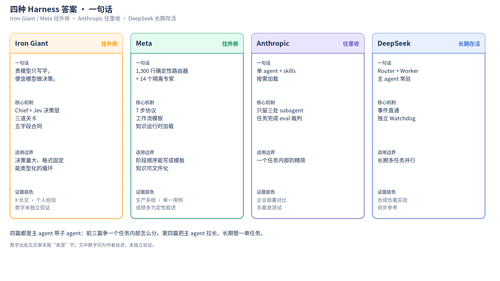
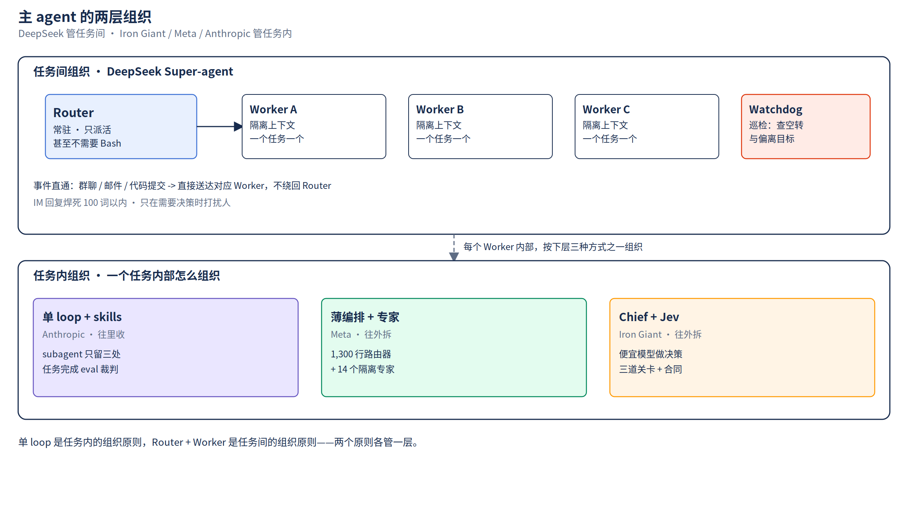
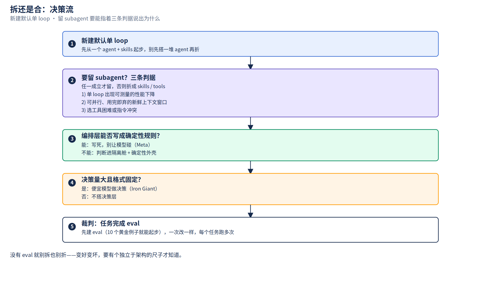

# Agent 拆还是合？四份一线 Harness 笔记的对照

[← 返回目录](index.html) · [English Version](./harness-comparison-en.md)

你正在搭一个 Agent 系统。第一个架构问题很快就来了：拆成多个 agent，还是一个 agent 干到底？

过去一段时间，我对照读了四份来自一线团队的设计笔记——Iron Giant 的 Grok Bot 实战、Meta 的 Thin Orchestrator、Anthropic 的折叠 subagent、DeepSeek 的 Super-agent。它们回答的是同一个问题：一个主 agent 和一群子 agent，活怎么分、谁说了算。四份笔记给的答案不一样，但分歧不在"要不要主从结构"——四篇都有主从结构。分歧在主 agent 该多瘦、子 agent 该留多少、主 agent 能活多久。

## 四种答案，一句话

- **Iron Giant：往外拆。** 贵模型只写字，便宜模型做决策，Harness 强制执行，Swarm 扩展。一个贵模型包办写入、路由、判断、批准和自查，所以凌晨 3 点会变慢、变贵、行为怪异。出路不是换更强的模型，而是分层。
- **Meta：往外拆，但编排层要足够笨。** 1,300 行、零领域工作的确定性路由器，只做意图分类、字段收集、可靠性检查和委派；全部领域推理下放到 14 个上下文隔离的专家子 agent。谁都看不到全图——这是 feature，不是 bug。
- **Anthropic：往里收。** 单 agent + skills 按需加载，subagent 只留三处，其余一次折一个、用 eval 说话。在多家企业部署的对比里，单 loop 经常打赢"一 prompt 包打天下"和"多 subagent"两种设计。
- **DeepSeek：也是主 agent 带子 agent，但主 agent 长期存活。** Super-agent = 常驻 Router + 隔离 Worker：Router 只派活，Worker 各干各的活。Router 不随任务结束而散，它长期管着一组并行任务，配事件直通和 Watchdog。瓶颈不在模型，在人的注意力——一个人同时最多跟进 3–5 个活跃会话。

## 它们先达成的四条共识

在分歧之前，先说四篇都同意的东西——这四条是底，分歧长在底之上。

**第一，病根在架构不在模型。** 四篇都没有把希望押在换更强模型上：Iron Giant 说出路是分层；Meta 说"这不是 prompt 工程问题，是架构问题"；Anthropic 说单 loop 打赢多 agent 靠的是结构不是模型；DeepSeek 的瓶颈是人的注意力，解法也是结构——Router + Worker + Watchdog，而不是等更强的模型。

**第二，上下文是稀缺品，管上下文是 harness 的主业。** Iron Giant 用文件代聊天；Meta 用隔离防污染；Anthropic 用渐进式发现防膨胀——agent 只看到 skills 和 tools 的短描述，需要时才完整加载；DeepSeek 的 Worker 同样上下文隔离，一个任务一个。

**第三，模型变强，harness 要让位。** Anthropic 说得最直白："每代新模型都让更多决策从 harness 回到模型手里"，僵硬的多 agent 结构反而会拦住新模型多干活。Iron Giant 每周五审计、收紧一条规则、退休一个 Bot，是同一条纪律的另一个版本；Meta 的各层独立演进、DeepSeek 的 Router 刻意不依赖模型能力（甚至不需要 Bash），都是同一条纪律：harness 别把自己焊死在某一代模型上。

**第四，测量说了算，感觉不算。** Iron Giant 有阈值与周五审计；Meta 有 7 步协议与委派前的可靠性门禁；Anthropic 把任务完成 eval 定为唯一裁判——先建 eval，一次改一样，不只看总分、要看哪些任务翻了；DeepSeek 用合成负载实验量效果、Watchdog 巡检跑偏。

## 真正的分歧：拆还是合

共识之下，分歧是直接对立的。Iron Giant 和 Meta 往外拆，Anthropic 往里收。

Anthropic 给这场争论提供了唯一的硬判据：**新建默认单 loop，留 subagent 要能指着三条说出为什么**——单 loop 因上下文膨胀出现可测量的性能下降；多任务可并行、用完即弃的新鲜上下文窗口；单 agent 选工具困难，或系统提示词里有冲突指令。指不出来，就折成 skills 和 tools。

注意这三条是"留"的判据，不是"建"的理由。很多团队的 agent 架构长成 org chart 的样子——每个能力归一个团队，每个团队建一个 subagent，上面再架一个编排器。Anthropic 点出的五种失败模式值得逐条对照：上下文交接丢信息、subagent 膨胀、Frankenprompt（每队往系统提示词里加一句、互相冲突）、各自为政的局部 eval、延迟。每多一次交接，就多一次信息损耗。

DeepSeek 也站在"拆"这一边——Router + Worker 本身就是主 agent 带子 agent 的拆法。拆还是合的问题，在它那里会再出现一次：每个 Worker 内部，一个任务怎么组织，仍要在单 loop、薄编排、Chief + Jev 三种方式里选（见图 2）。所以拆合不是一道二选一，而是在每一层重复出现的取舍。

拆合定了方向，下一个问题是：分出去的专家，谁来管？

## 专家怎么管：合同、结构、所有权、寿命

四篇对"专家怎么管"给了四种不同的答案：

- **Iron Giant 管合同**：每个 Bot 五字段合同——工作、来源、判断、输出、禁做。不管专家内部怎么长，只管它对外守什么合同。一句话就值回票价："填不出禁做事项，就说明这个角色还没想清楚。"
- **Meta 管结构**：子 agent 结构统一——知识源、必需输入、执行步骤、错误处理四件套一致；知识运行时加载，更新即时生效。不管专家懂什么，只管它结构长一个样。
- **Anthropic 管所有权**：每队拥有 skills 和 tools，一个小中央团队持有系统提示词与端到端质量，每项新 skill、tool、eval 上线前审核。各队设负责人管自己的 skills，配专人定期删死重。
- **DeepSeek 管寿命**：Router 只派活不管执行，Watchdog 只巡检不管业务——主 agent 长期存活，管的是任务的进出与跑偏，不是任务本身。

## 决策的三种做法

决策放哪一层，四篇给了三个做法——DeepSeek 的 Router 走的是 Meta 那条确定性派活的路：

- **Iron Giant 把决策交给便宜模型**：Jev 只答类型化问题——选择、1–5 评分、0–1 概率，不写散文；阈值升级兜底。决策量大、格式固定的循环，这是最实在的省钱办法。提醒一句：Jev 是 TypeSafe AI 的 hosted 模型，用它等于引入一家厂商依赖。若想避免锁定，可用本地小模型或规则引擎做同样的类型化决策层；同类里也有开源权重可自己跑的，比如 [AWS Strands Decider](https://stoneskin.github.io/writings/ai-learning/decision-models-and-jev-summary.html)（Apache 2.0）。
- **Meta 把决策写成确定性规则**：路由本身就是确定性决策，不用 LLM；推理全下放。7 步协议里只有委派那一步涉及 LLM 推理，且发生在子 agent 的隔离上下文内。
- **Anthropic 让模型自己做决策**：模型变强，决策权从 harness 回到模型手里。硬规则不写进散文，写进 tools——校验、审批、前置条件、权限由代码强制。
- **DeepSeek 的 Router 也是确定性派活那一路**：它一次批量处理多个任务的派活，把单次决策成本摊薄了（批量后单次决策时间从 6.4 秒降到 1.6 秒，合成负载实验）。

三条路没有一条是"让贵模型自由裁量"——贵模型只配干执行。举个我自己项目里的例子：开源项目 muse-thinktank（https://github.com/stoneskin/muse-thinktank）里，陪审团的 judge 要对多个模型的不同意见做实质裁决——不能全类型化（Iron Giant 那段不够），不能全确定性（Meta 那段不够），也不能交给模型自由裁量。三条路各取一段：类型化评分 + 确定性外壳 + 任务完成 eval 当裁判。

决策说完了，回到 DeepSeek——它和 Meta 看着像，但寿命不一样。

## 同一结构，拉长时间：主 agent 长期存活

DeepSeek 的 Router + Worker，看起来和 Meta 的 Thin Orchestrator 几乎一样——瘦编排层加上下文隔离的执行者，编排本身不干领域活。确实一样，这是同一个结构模式。差别不在结构，在主 agent 的寿命：Meta 的编排只活一个任务，任务结束就散了；DeepSeek 的 Router 常驻，长期管着一组并行任务。

主 agent 一旦长期存活，新的问题才出现，DeepSeek 的答案是四件东西：**事件直通**——群聊、邮件、代码提交都是触发器，后续事件由程序直送对应的 Worker，不再绕回 Router；**异步 + 注意力预算**——长任务全改异步，IM 回复焊死 100 词以内，只在需要决策时打扰人；**独立 Watchdog**——不只看进程死没死，更查模型是不是空转或偏离目标；**计算、状态、环境彻底解耦**——云端跑 loop、数据库存状态、执行环境留在用户自己的机器上，模型自带（BYOM）。

所以 DeepSeek 不是第四种答案，而是第一种结构拉长时间之后的样子：主 agent 不死，任务一个接一个来，harness 要补的件就从"怎么分"变成了"怎么长期管"。

## 落地时怎么取舍

读完四篇，我的取舍框架是四步：

**1. 先认结构，再看寿命。** 四篇都是主 agent 带子 agent，先认清这一点；再问你的主 agent 活多久：只活一个任务，还是长期存活、管一串任务？多数长期运行的助手是后者里跑前者：外层是常驻 Router 组织多任务，内层每个任务再按单 loop / 多 agent 的取舍组织。

**2. 拆还是合：默认单 loop，三条判据。** 新建默认单 loop；留 subagent 指着三条判据说出为什么。指不出来就折成 skills/tools。

**3. 编排层能不能写成确定性规则？** 能——写死，别让模型碰。不能——把判断交给隔离舱里的推理 + 确定性外壳。编排层一旦自己开始幻觉，错误扩散到全部下游。

**4. 决策量大且格式固定，才值得便宜化。** 不大或不固定，别为省钱搭一套决策层。裁判永远是任务完成 eval：10 个黄金例子就能起步，一次改一样，每个任务跑多次。没有 eval 就别拆也别折——变好变坏，要有个独立于架构的尺子才知道。

## Agent 越少，模型越要强

上面四篇还有一个没明说的变量：模型本身。

Agent 越少，单个 agent 要扛的东西越多，对模型能力的要求就越高——更长的上下文、更多的工具、更复杂的指令，全压在一个 loop 里。Meta 的教训正反两面都讲了这件事：模型够强，大上下文扛得住；模型不够强，拆开反而效果更好。Anthropic 的第一条保留标准说的也是同一件事：单 loop 出现可测量的性能下降，就把 subagent 留下来。

所以 Anthropic 的"折"这个结论，不是模型中立的。它的**方法**是模型中立的——先建 eval，一次折一个，量了再说；但它的**结论**是跟着模型能力走的：Claude 够强，折才赢。换一个弱模型进同一个单 loop，上下文一膨胀性能就掉，按 Anthropic 自己的标准就得再拆出来。模型越强，越能折；模型变强，harness 让位——说的都是同一件事。

反过来也成立：不一定非要大模型。[《Agentic Design Patterns》](https://github.com/evoiz/Agentic-Design-Patterns)（Antonio Gulli 著，第 17 章 Reasoning Techniques）里讲 test-time compute：多个小模型多次推理，也能达到大参数模型相似的高质量——质量不一定靠更大的模型，也能靠推理时多花算力换来。多 agent 协作本身就是这个思想的一个实现。拆的代价是协调成本，合的代价是模型成本；选模型、选架构，不能只问"能不能完成工作"，还要问"花多少钱、多大代价"。便宜模型做决策、贵模型只干执行（Iron Giant），简单查询走便宜模型、复杂查询走贵模型（路由模式），本质上都是在算这笔账。

## 关于数字：先说清楚出处

这四篇里的数字，引用时要连出处一起引用：Iron Giant 的"约便宜 58 倍""每天 $49 对 $0.84"是作者自述，未独立验证；Meta 最抓眼球的"65.3% 对 16.6%"、"token 降 65 倍"出自一篇外部预印本，不是 Meta 自家系统的实测，Meta 自家只给了时间数（配置准备 3–4 天降到不到 1 小时）；Anthropic 的"快约 2 倍"是一家客户的实测，不是普遍结论；DeepSeek 的"p50 12.4 分钟、Token 近 4 倍"是合成负载实验，且原文为转贴，初步参考。数字不带出处，就是谣言的半成品。

## 我的体会

四篇读下来，我的体会是：harness 的问题从来不是"多 agent 好还是单 agent 好"，而是"你的系统里，什么在变、什么不变"。模型每个季度都在变强，写死的 harness 不跟着变，就会从脚手架变成天花板。所以每加一个部件，都要能说出它补的是模型的哪块短板；短板没了，就拆。

还有一点，来自我正在做的项目：把一个成熟的 agent 当作专家模块、按合同接入，比争论拆合更有用。调用方只按合同调用，不关心它内部是单 loop 还是多 agent；它内部拆还是合，由它自己的 eval 决定。

## 讨论

你正在做的 Agent 系统里，有没有一个 subagent 是"流程上分了一步"、其实可以折成 skill 的？或者反过来，有没有一个单 loop 已经出现可测量的性能下降、该拆了？你是怎么判的？欢迎直接贴你的架构草图或一个具体决策点，一起对照这四份笔记看。

---

**来源**

1. Iron Giant《Your Grok Bot Is Burning Money — Harness Fixes It》，X Article，2026-11-17：https://x.com/irongiantXBT/status/2122662343306059780
2. Meta《The Thin Orchestrator》，Meta Engineering Blog，2026-10-19：https://engineering.fb.com/2026/10/19/ml-applications/thin-orchestrator-ai-agent-architecture/
3. Anthropic，Diane Sarkis《Building agents: When to fold subagents into your main agent loop》，2026-10-22：https://claude.com/resources/articles/building-agents-when-to-fold-subagents-into-your-main-agent-loop
4. DeepSeek Harness 团队《Super-agent 设计探索》，2026-10-31（转贴）：https://www.uied.cn/posts/922127
5. Antonio Gulli《Agentic Design Patterns》，第 17 章 Reasoning Techniques（test-time compute）：https://github.com/evoiz/Agentic-Design-Patterns
