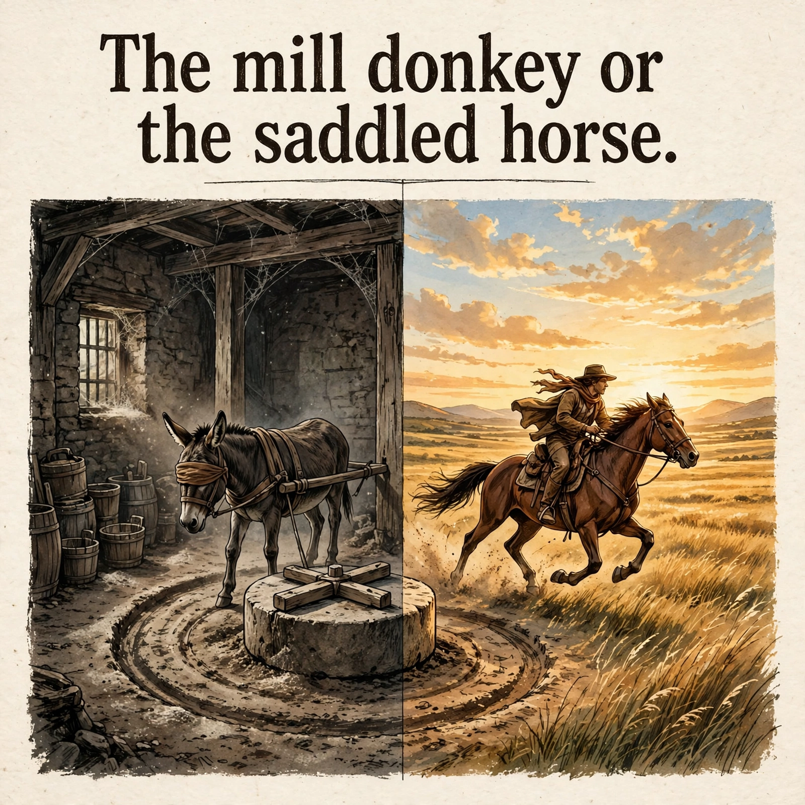

# The Mill Donkey or the Saddled Horse

[← 返回首页](../index.md)

*2026-11-16 · [中文版](./mill-donkey-or-saddled-horse-zh.md)*

While I was studying AI harnesses and sketching the design of an agent, two images kept appearing in my head. One is the donkey in the mill: blindfolded, yoked to the grindstone, not allowed a single step off track, walking the same circle over and over. The other is a saddled horse: under a rider's guidance, galloping fast in a chosen direction.

The donkey's setup is very safe. Every step is repeatable, every step is correct, and the miller sleeps well at night. The problem is that after a thousand turns of the millstone, the donkey is still in the same place. The price of safe and repeatable is never getting anywhere.

The horse's setup looks less safe. A horse has its own strength and temper; it runs fast, and it can run off course. But a saddle is not there to tie the horse down. It is there to turn the rider's direction into the horse's direction. One pull on the reins, and all that power has somewhere to go.

Both are called a harness, but their design intents are exact opposites. One prevents escape; the other gives direction. So the real question in harness design is not "should we keep AI under control" but "what is this harness for" — are you building a prison, or fitting a saddle?

People who fear AI will always choose the former. To them, AI is a monster with terrifying power, something to be watched closely and used strictly, like a slave or a prisoner. That fear is not unreasonable — great power does deserve caution. But once you design all the way down that logic, AI can only repeat steps that have already been proven. The system never learns to run, and the organization never learns to ride.

People who treat AI as a partner and teammate choose the latter. The harness they want is not there to prove AI untrustworthy. It is there to let AI perform better and work with humans more closely. Safety does not come from tying the legs together. It comes from the rider watching the road and the field having clear boundaries. A saddle never made a horse harmless. It made the horse steerable.

Of course, the horse's way has its own way to fail, and it is not in the horse — it is in the rider. Reins only work when the rider is actually watching the road. The thing human-on-the-loop should fear most is not the AI drifting off course, it is the human falling asleep. I have to be honest about this: I drift off too. Handing over the wheel is easy; keeping your eyes on the road is the hard part.

So the answer is probably not one choice for the whole system, but a choice per action. For irreversible actions — paging someone, moving money, filing a formal ticket — use the donkey's mode: fully deterministic, not a single step wrong. For actions that need judgment — investigating, diagnosing, drafting a plan — saddle up, let it run, and keep the human beside it watching the direction. A donkey and a horse can live in the same system, each covering its own stretch of road.

In the end, one question is enough: is what I am designing a prison or a saddle? If the answer is a prison, no matter how powerful the AI, it will only walk in circles. If the answer is a saddle, once the direction is right, it will run faster than you imagined. A harness was never meant to prove that AI cannot be trusted. It is meant to let trustworthy AI run faster.
