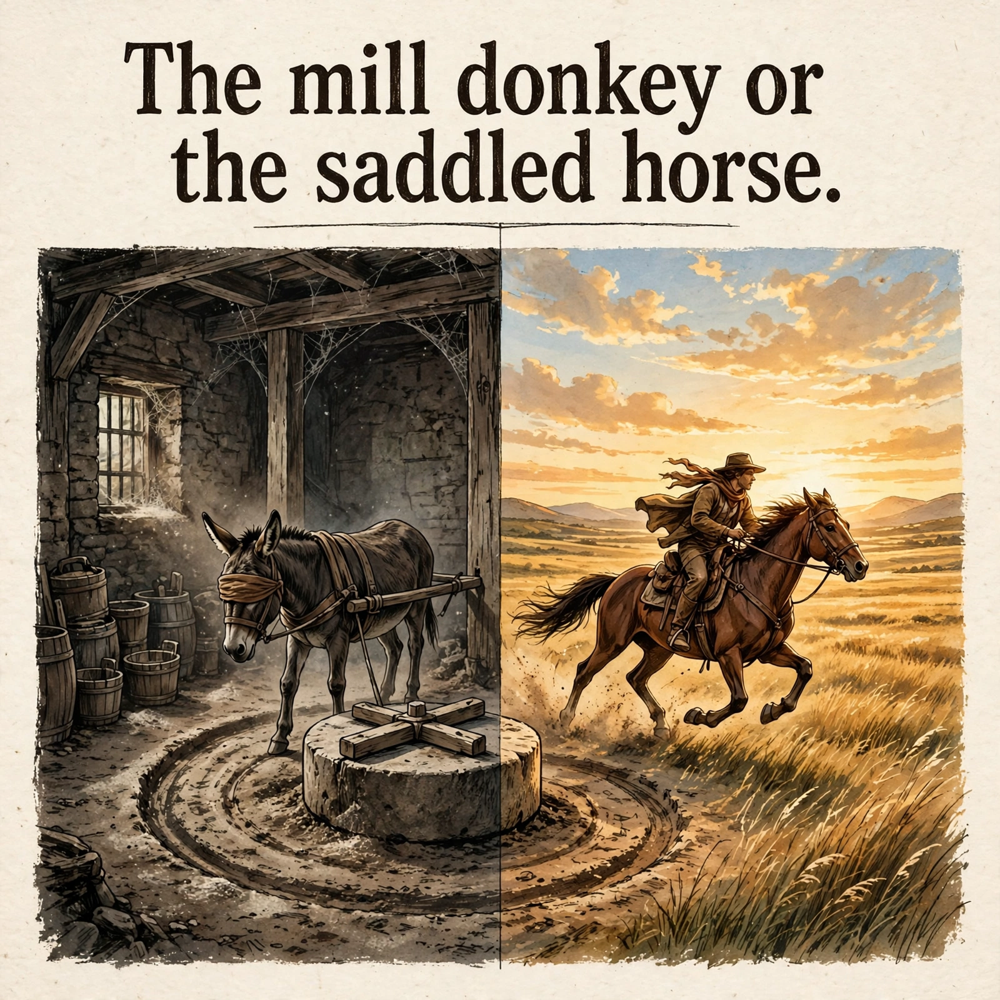

# 磨坊里的驴，还是上了鞍的马

[← 返回首页](../index.md)

*2026-11-16 · [English Version](./mill-donkey-or-saddled-horse-en.md)*

最近在学 AI harness、画一个 agent 的设计图时，脑袋里一直有两幅画面。一幅是磨坊里的驴：蒙着眼，套着磨，一步也不能跨错，只能沿着既定的轨迹一圈一圈地走。另一幅是套上鞍具的马：在人的驾驭下，朝着既定的方向快速驰骋。

驴的那套东西很安全。每一步都可复用，每一步都不会错，磨坊主晚上能睡安稳觉。问题是磨转了一千圈，驴还在原地。安全复用的代价，是永远到不了任何地方。

马的那套东西看起来没那么安全。马有自己的力气和脾气，跑起来快，也可能跑偏。但马鞍不是为了把马捆住，是为了让人的方向变成马的方向。缰绳一带，力量就有了去处。

两样东西都叫 harness，设计意图却完全相反。一个是防逃跑的，一个是给方向的。所以做 harness 设计时真正的问题不是“要不要管住 AI”，而是“你这套 harness 到底是用来干什么的”——是造一座监狱，还是备一副马鞍。

恐惧 AI 的人一定会选前者。对他们来说，AI 是有着恐怖力量的怪物，只能像奴隶和囚犯一样被严密监视、严格使用。这种恐惧不是没道理，力量大了确实要小心。可是一旦按这个逻辑把 harness 设计到底，AI 就只能重复已经被验证过的每一步，系统永远学不会跑，组织也永远学不会骑马。

而把 AI 当伙伴和队友的人，会选后者。他们要的 harness 不是为了证明 AI 不可信，是为了让 AI 更好地发挥能力、和人更协同地工作。安全不靠把腿捆住，靠骑手看着方向、靠场地划好边界。马鞍从来没让马变无害，它让马变得可驾驭。

当然，马这条路也有自己的翻车点，而且不在马身上，在骑手身上。缰绳只有骑手真的看着路时才起作用。Human on the loop 最怕的不是 AI 跑偏，是人睡着了。这一点我得诚实承认：我自己也有走神的时候，方向盘交出去容易，眼睛一直盯着路难。

所以答案可能不是全系统二选一，而是按动作分。不可逆的动作——拉警报、动钱、开正式的单子——就用驴模式，确定性走到底，一步都不能错；要判断力的动作——调查、诊断、写方案——就给它上鞍，让它跑，人在旁边看着方向。同一套系统里，驴和马可以同时存在，各管各的路段。

最后问自己一句就够了：我设计的这套东西，是监狱还是马鞍？如果答案是监狱，AI 再强也只能原地打圈；如果答案是马鞍，方向对了，它跑起来的速度会超出你的想象。harness 的意义，从来不是证明 AI 不值得信任，而是让值得信任的 AI 跑得更快。
